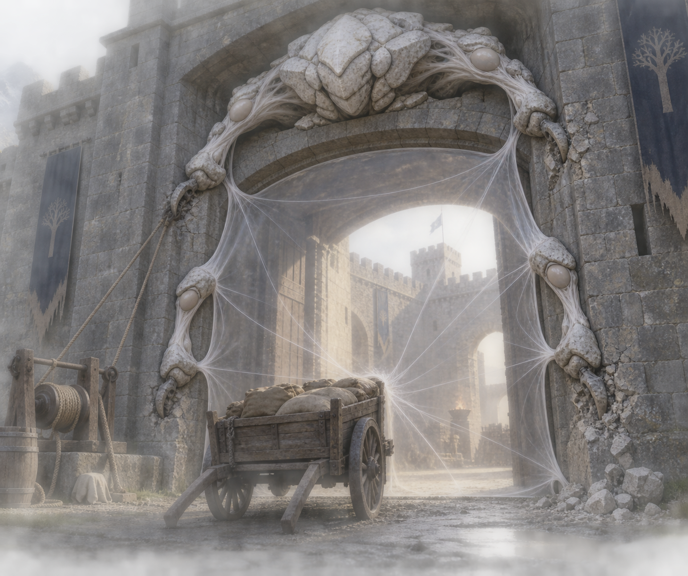

# 🛡️ Les Enclos

[← Bestiaire](BESTIAIRE.md) · [Regroupements](REGROUPEMENTS.md) · [Protection humaine](../magies/PROTECTION_V1.md)

## 📌 Statut

Fiche issue de la discussion, enregistrée à la demande de l’utilisateur. Elle développe l’Enclos comme une **créature qui déploie son corps autour de ce qu’elle conserve**. Anatomie, spécialisations et exemple ci-dessous constituent le développement proposé ; conditions particulières de naissance, reproduction, alimentation précise et performances restent ouvertes.

L’Enclos est instinctif et moralement neutre. Il ne reconnaît ni alliés, ni ennemis, ni intentions. Son activité naturelle ne demande pas de rituel humain ni d’accord entre praticiens.

## 👁️ Proposition visuelle

[Image complète](../visuels/enclos-v1.png) · [Prompt de génération](../visuels/enclos-v1-prompt.md)

Cette illustration propose une anatomie ; elle ne fixe ni dimensions universelles ni capacités supplémentaires.

## 🧩 Anatomie

| Partie du corps | Fonction |
|---|---|
| Membres d’ancrage | S’enfoncent dans les sols et les murs, maintiennent la position et transmettent les efforts. |
| Filaments tendus | Relient les membres et constituent les coutures de la frontière. |
| Membranes filtrantes | Occupent les espaces entre filaments ; leur substance détermine ce qu’elles arrêtent. |
| Organes récepteurs | Reçoivent les contraintes : poches qui chauffent, masses qui se soulèvent, tissus qui se compriment. |

Le corps forme la frontière de son territoire. Quand un projectile frappe une membrane, les filaments se tendent, les membres s’arc-boutent et les organes récepteurs se chargent. Une attaque peut arracher un ancrage ou rompre une couture.

La compression et le soulèvement stockent de l’énergie ; ils ne la font pas disparaître. Retour au repos, dissipation et refroidissement demandent des mécanismes dont les détails restent à concevoir.

## 🪢 Instinct : entourer et retenir

L’Enclos recherche des cavités et des passages où déployer son corps. Il fixe ses membres, ferme une ouverture, éprouve les contraintes et étend sa frontière.

Une brèche déclenche une contraction et la croissance de nouveaux filaments. Une poussée depuis l’intérieur provoque la même recherche de fermeture qu’une poussée depuis l’extérieur.

Il peut donc emprisonner sans reconnaître des prisonniers. La membrane qui arrête les solides retient aussi bien les assaillants que les habitants qui veulent sortir. Conserver son contenu décrit le résultat de ce comportement, sans supposer une volonté de possession consciente.

## 💎 Spécialisations proposées

La substance du corps reprend les filtres concrets de la Protection. Les variantes suivantes prolongent les trois préparations humaines ; leur biologie reste à développer.

| Variante | Filtre | Conséquences corporelles et limites |
|---|---|---|
| Silex blanc | Solides | Tractions et déformations transmises aux appuis ; ne trie pas les personnes ou les objets. Air et lumière peuvent passer. |
| Émail de braise | Transferts de chaleur | Organes récepteurs qui chauffent et doivent dissiper ; ne protège pas automatiquement des fumées ou du manque d’air. |
| Sel bleu | Eau liquide | Pression croissante sur le corps et ses appuis ; ne filtre pas automatiquement vapeur, gaz ou toutes les substances dissoutes. |

Un individu spécialisé ne possède pas tous les filtres. Plusieurs Enclos pourraient se superposer, mais leurs ancrages, membranes et besoins d’évacuation peuvent se gêner. Aucune protection universelle n’est acquise.

## ⚡ Besoins et défaillances

L’Enclos a besoin d’appuis résistants, d’espace pour déployer ses organes et de moyens de supporter ou d’évacuer les contraintes reçues. Croissance et activité ne créent ni matière ni énergie ; leurs ressources exactes restent à définir.

- Une membrane intacte peut arracher le mur auquel elle est attachée.
- Un récepteur thermique saturé ne peut pas absorber indéfiniment la chaleur.
- L’eau retenue reste présente et peut augmenter la pression.
- Une ouverture locale laisse passer ce que la membrane arrêtait.
- Interrompre l’activité magique n’efface ni chaleur, ni eau accumulée, ni dégâts déjà produits.

## 🧙 Supervision par un retourné

Le superviseur prépare les appuis, oriente les attaches, entretient les récepteurs et apprend à provoquer des ouvertures locales. Il agit sur le corps et les réactions de la créature, sans lui faire comprendre un règlement d’accès.

Une ouverture constitue une rupture que l’Enclos tend à refermer. La maintenir demande un dispositif ou une intervention adaptés à l’individu et à la charge reçue.

L’intérêt recherché est une protection autonome, sans protecteur humain en maintien permanent. Cette autonomie ne garantit ni obéissance ni sécurité des personnes enfermées.

## 🚪 Exemple proposé : la porte nord du Bastion

Cette scène illustre une utilisation possible ; elle n’établit pas que le Bastion a intégré des Non-Vivants à ses défenses ordinaires. Son manuel v1 reste fondé sur des humains et des installations.

### L’installation

Un Enclos à silex blanc, grand comme un bœuf, repose dans une niche au-dessus de la porte nord. Six pattes descendent le long des montants et s’enfoncent dans la pierre. Entre elles, les filaments blancs tendent une membrane presque transparente sur toute l’ouverture. L’air passe ; les solides sont bloqués.

Cette taille et ces six pattes caractérisent l’exemple, pas toute la famille.

### Le choc

Une charrette heurte la membrane. Celle-ci s’enfonce légèrement. Les filaments tirent sur les pattes ; deux articulations épaisses se replient sous l’effort. La pierre grince autour des griffes.

La charrette s’arrête, mais une patte est déchaussée. L’Enclos la retire, tâtonne et l’enfonce dans un joint voisin. La membrane se retend.

### L’entretien et le passage

Les habitants renforcent ses appuis. Dans cet exemple, une réserve de gemmes raccordée à sa niche fournit du travail à son activité : **ce mode d’alimentation est proposé, son interface et ses besoins restent à définir**.

Pour faire passer les provisions, sa superviseuse actionne un treuil qui rapproche deux pattes. Un bord de la membrane se détend et une ouverture apparaît. L’Enclos cherche à réécarter ses membres : le treuil doit tenir pendant tout le passage. Cette manœuvre appartient au montage de cet exemple, sans garantir une méthode universelle de contention.

### L’incendie

Un incendie éclate dans le quartier. La foule pousse vers la porte. L’Enclos réagit comme à la charrette : il raidit ses pattes et renforce la fermeture. Il ne reconnaît pas une évacuation.

La superviseuse tourne le treuil. Sous la pression, le mécanisme ne parvient plus à rapprocher les pattes. Il faut faire reculer les gens, ou arracher un ancrage au risque que la membrane cède brutalement.

**La créature accomplit toujours ce pour quoi on l’a installée : elle tient la porte.**

## 🕸️ Dans les Couvées

L’Enclos constitue la fermeture physique autour de la population. Les Peaux de peur entretiennent l’inquiétude ; le Saint affamé entretient la croyance protectrice. Ces autres créatures agissent sur le milieu humain ; elles ne donnent pas à l’Enclos une compréhension des fidèles.

Le superviseur doit préserver à la fois les conditions matérielles de la frontière et celles de la communauté. Une population qui veut fuir peut surcharger les membranes qui la défendent.

## ❓ Paramètres ouverts

Conditions particulières de naissance, reproduction, locomotion hors d’un ancrage, ressources de croissance, alimentation, dissipation des efforts, nombre et disposition des membres, dimensions, filtres accessibles, durée de maintien et réactions à la perte d’une partie du corps. Aucun coût ni seuil de résistance chiffré n’est fixé.
