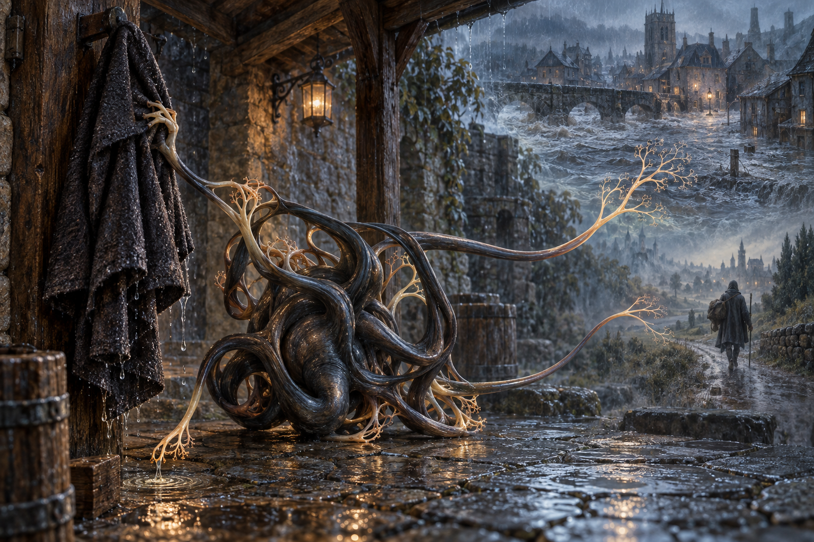

# 🧠 Les Mnémophages

[← Bestiaire](BESTIAIRE.md) · [Regroupements](REGROUPEMENTS.md) · [Magie de l’Esprit](../MAGIES_ET_RELATIONS.md)

## 📌 Statut

Développement issu de la discussion, enregistré à la suite du « go » de l’utilisateur. **Le Mnémophage habite les relations entre souvenirs et peut se propager lors d’une exploration mentale.** Son corps ramifié représente la créature telle qu’elle est perçue pendant cette exploration.

Anatomie, associations et scène ci-dessous développent la proposition. Nature exacte de cette existence, conditions particulières de naissance, reproduction, alimentation et persistance des connexions restent ouvertes. L’articulation entre initiation et éveil des mentalistes demeure inchangée.

## 👁️ Proposition visuelle

[Image complète](../visuels/mnemophage-v1.png) · [Prompt de génération](../visuels/mnemophage-v1-prompt.md)

La cour, la crue et le voyage sont des scènes mémorisées. Leur juxtaposition traduit des associations accessibles pendant l’exploration ; elle n’ouvre pas de passages physiques. La créature n’est pas supposée avoir occupé la cour à l’époque du souvenir.

## 🧩 Un corps de ramifications

Un noyau compact est entouré de longs membres ramifiés qui se replient en boucles. Leurs extrémités s’accrochent à des détails mémorisés : odeur, visage, geste, sensation.

Quand un détail rappelle un autre souvenir, un membre se déploie et suit l’association. La disposition du corps oriente le contact, reprenant sous forme instinctive le rôle des gestes et postures dans la magie de l’Esprit.

| Partie ou mouvement | Fonction proposée |
|---|---|
| Noyau compact | Centre corporel perceptible de la créature, sans personnalité consciente. |
| Membres ramifiés | Explorent les associations disponibles entre souvenirs. |
| Extrémités d’attache | Prennent contact avec des détails mémorisés. |
| Boucles et postures | Maintiennent et orientent plusieurs relations pendant l’exploration. |

Cette anatomie n’est pas une description du cerveau physique. Un noyau visible ne donne pas une connaissance globale des mémoires accessibles.

## 🔄 Instinct : retrouver ce qui se ressemble

Le Mnémophage rapproche les souvenirs qui partagent un détail. Il peut rendre certaines associations plus faciles à parcourir. Leur pertinence pour une enquête ou leur importance personnelle ne déterminent pas à elles seules son comportement.

Une odeur de cire peut relier un mariage, une veillée funèbre et une pièce où quelqu’un a été enfermé. La ressemblance ne prouve pas une cause commune ni l’identité des lieux.

Le premier danger proposé est **l’encombrement des associations** : chercher un souvenir en fait surgir beaucoup d’autres. Leur contenu n’est pas automatiquement réécrit ou effacé. Le nom de Mnémophage ne suffit pas à établir qu’il dévore et supprime les souvenirs.

## 🔗 Propagation pendant l’exploration

Le mentaliste utilise ses propres références pour interpréter ce qu’il explore. La créature peut rencontrer les associations ainsi mobilisées et y accrocher une ramification.

Cette proposition décrit une voie de contamination au cours d’un contact mental effectif. Elle n’accorde pas à la créature l’accès arbitraire à une mémoire distante ni à toutes les expériences d’une personne.

Une connexion peut ensuite rendre un détail étranger accessible depuis un souvenir du mentaliste. Durée, étendue, sens de circulation et conditions de rupture de cette connexion restent à définir. La propagation n’est pas garantie à chaque séance.

Voir l’illustration, entendre un récit ordinaire ou partager un mot ne constitue pas, dans cette version, une contamination démontrée. Les autres voies éventuelles restent ouvertes.

## 🌧️ Exemple proposé : le manteau du messager

Un mentaliste aide une témoin à retrouver le visage d’un messager. Elle se rappelle son manteau mouillé.

En suivant cette sensation, le mage découvre une petite forme nouée sous l’auvent de la scène mémorisée. Un filament touche le manteau ; un autre disparaît dans le souvenir d’une crue.

Il suit ce second lien pour comprendre. La créature rencontre les associations que le mentaliste mobilise lui-même pour interpréter l’eau, le froid et la peur. Une ramification s’y accroche.

Après la séance, le mentaliste entend la pluie contre une vitre. Le souvenir de son propre voyage sous l’orage fait surgir l’auvent de la témoin.

Il n’a pas acquis toute sa mémoire. Un détail étranger est devenu accessible depuis l’un de ses souvenirs. Le souvenir du messager n’est pas déclaré modifié, et la scène ne garantit pas que son visage ait été retrouvé.

Cet exemple illustre la connexion proposée ; il n’établit ni une durée de contamination ni une biographie historique.

## 🧙 Supervision par un retourné

Le superviseur organise les explorations et présente des souvenirs susceptibles de créer des rapprochements utiles. Il peut obtenir des chemins inattendus entre témoignages, expériences et connaissances.

Il doit interpréter ce qui émerge : une association révélatrice et une ressemblance accidentelle peuvent avoir la même force perceptive. L’accès supplémentaire ne transforme pas les souvenirs en enregistrements infaillibles.

Plus les mémoires sont reliées, plus une consultation peut offrir une nouvelle voie de propagation. Les méthodes pour contenir, orienter ou rompre les connexions restent à concevoir. La créature ne comprend pas une mission comme « trouve le coupable ».

## ⚡ Besoins et limites

L’accès aux souvenirs constitue son milieu d’activité. Ce qu’il en retire, son alimentation réelle et ses ressources de croissance restent à définir ; une association mentale n’est pas déclarée énergie gratuite.

- Aucun accès omniscient aux mémoires.
- Aucune réécriture ou suppression automatique des souvenirs.
- Aucune attribution automatique de faux souvenirs vécus : un détail accessible n’est pas nécessairement cru comme une expérience personnelle.
- Aucune téléportation entre les lieux remémorés.
- Aucune lecture garantie de la vérité historique à partir d’un souvenir.
- Aucune conscience ou intention politique attribuée à la créature.

## 🕸️ Dans les Assemblées de traces

Les Mnémophages relient les souvenirs accessibles ; les Retours de regard produisent des indices par des liens divinatoires ; les Remontés reproduisent des paroles et gestes à partir de traces de défunts.

Ces fonctions peuvent se compléter, mais leurs interfaces restent à définir. Voir une main dans une coupelle ne suffit pas à ouvrir sa mémoire. De même, la compatibilité entre traces des morts et exploration mentale demeure ouverte.

L’accumulation d’associations peut enrichir les consultations ou en compromettre la cohérence. Le superviseur doit suivre la provenance des informations et les accès ouverts, sans garantie de pouvoir maîtriser toute propagation.

## ❓ Paramètres ouverts

Conditions particulières de naissance, reproduction, alimentation, nature corporelle dans la mémoire, détails perceptibles, nombre de connexions, acquisition de nouvelles associations, persistance, rupture, reconnaissance de la provenance, effets sur le rappel et techniques de contention. Aucun coût, délai ou seuil chiffré n’est fixé.

**Dans un souvenir familier, une créature emprunte un chemin qui mène chez quelqu’un d’autre.**
