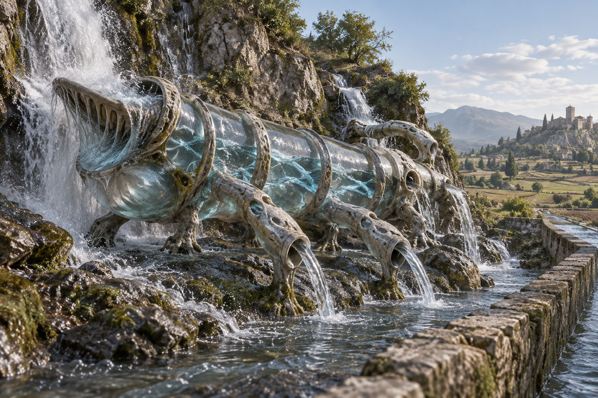

# 🔥 Les Obstinés

[← Bestiaire](BESTIAIRE.md) · [Regroupements](REGROUPEMENTS.md) · [Magie élémentaire humaine](../magies/ELEMENTAIRE_V1.md)

## 📌 Statut

Développement issu de la discussion, enregistré à la demande de l’utilisateur. Le nom et le principe sont conservés : **un ordre élémentaire devenu un instinct corporel**. Anatomie et exemple ci-dessous développent cette proposition ; naissance, reproduction, croissance et performances restent ouvertes.

Les Obstinés sont des créatures instinctives, moralement neutres. Un ordre qui persiste ne signifie pas une volonté consciente. Leur activité naturelle ne demande ni présence ni permission d’un mage.

## 👁️ Proposition visuelle : l’Obstiné d’eau

[Image complète](../visuels/obstine-eau-v1.png) · [Prompt de génération](../visuels/obstine-eau-v1-prompt.md)

Cette silhouette illustre un individu d’eau ; elle ne fixe pas l’anatomie de toutes les variantes élémentaires.

## 🧩 Un corps qui conduit un phénomène

L’Obstiné répète une manière d’agir sur un élément : prendre, conduire, rassembler ou répartir, par exemple. Son anatomie reprend les fonctions de la pratique élémentaire.

| Organe | Fonction proposée |
|---|---|
| Organes de prise | Recueillent une ressource réellement disponible dans le milieu. |
| Conduits corporels | Transportent l’élément sur un trajet continu. |
| Membres mobiles | Orientent les sorties et règlent la conduite par leur posture. |
| Chambres résonantes | Produisent un grondement rythmé qui accompagne l’opération, comme une parole devenue cri animal. |
| Structures annulaires et sillons | Délimitent les prises et les opérations dans le corps, à la manière des cercles et runes humains. |
| Ouvertures de décharge | Évacuent les excès vers le milieu réel. |

Les mouvements accomplissent les gestes ; les vocalisations ne constituent pas un langage conscient. Le lien précis entre son cri, ses postures et le maintien de l’effet reste à développer. Les moyens d’interrompre un mage humain ne sont pas automatiquement des moyens garantis d’arrêter la créature.

## 🔄 Instinct et ressources

Chaque individu porte un comportement élémentaire persistant. Il ne maîtrise pas implicitement tous les éléments et toutes les opérations.

Il ajuste ses prises et ses sorties selon des réactions au milieu. Ces adaptations peuvent être complexes sans représenter un projet ni une compréhension des besoins humains.

- Il ne crée ni matière ni énergie.
- La ressource traitée et le travail nécessaire doivent être disponibles.
- Répartir un flux partage son débit ; les branches ne le dupliquent pas.
- Ralentir ou détourner produit des contraintes et des dissipations.
- Les appuis de son corps reprennent les efforts de la conduite.
- Une décharge doit aboutir quelque part ; elle peut menacer ce qui se trouve en aval.
- Arrêter une prise n’efface pas l’eau, la chaleur ou le mouvement déjà transmis.

La façon dont un Obstiné incorpore des matériaux pour grandir reste à définir. L’image d’un corps composite ne donne pas gratuitement une transmutation ou les pouvoirs de Matière.

## 🌊 Exemple proposé : l’Obstiné du canal

### Le corps

Au pied d’une chute vit une longue bête aplatie. Des gaines translucides sont tendues entre ses anneaux minéraux. Une large bouche reçoit l’eau ; le courant traverse son ventre et ressort par plusieurs membres tubulaires qu’elle oriente vers un canal situé plus bas.

Des membres d’appui maintiennent le corps contre les rochers. Des ouvertures latérales laissent déborder les excès dans le lit de la rivière. La chute fournit le travail disponible pour la conduite ; aucune élévation arbitraire ni puissance supplémentaire n’est acquise. Le métabolisme et les besoins de croissance restent ouverts.

### Le comportement utile

Son instinct est de **rassembler les arrivées et de les conduire vers une sortie stable**.

Un retourné l’installe à l’entrée d’un canal d’irrigation. La créature capte des écoulements dispersés et les rassemble vers cette sortie. Elle ajuste ses prises lorsque le lit se déplace. Les champs reçoivent de l’eau plus régulièrement.

Ce résultat dépend de la chute, des apports, des appuis et de la capacité du canal ; il ne constitue pas une garantie universelle de régulation.

### La crue

Une crue ouvre un bras vers le village. L’Obstiné y étend une prise et rassemble ce courant supplémentaire dans le même canal.

Le canal déborde. Les écoulements dispersés continuent de stimuler les prises de la créature. Ses décharges ne suffisent pas à rendre l’ensemble sûr pour les habitants : elles rendent l’eau au milieu, sans choisir une destination inoffensive.

Le superviseur doit détourner une arrivée ou déplacer la sortie. Crier « arrête » ne lui communique pas un ordre compris. Le grondement continue, les membres tiennent leur posture et l’eau passe.

L’exemple ne fixe ni débit, ni portée des prises, ni vitesse d’adaptation. Il montre comment une activité localement utile devient dangereuse lorsque les apports changent.

## 🧙 Supervision par un retourné

Le superviseur prépare les ressources, les appuis et les débouchés. Il oriente un comportement existant en modifiant les conditions matérielles de son exercice.

Il gagne une conduite autonome du phénomène. Il doit surveiller les prises nouvelles, les contraintes et les récepteurs. Une sortie stable pour la créature peut être trop étroite ou mal située pour les humains.

Les techniques d’attraction, de déplacement et de contention restent à concevoir. La disparition du superviseur n’arrête pas nécessairement l’opération.

## 🏺 Différence avec les Greffiers

L’Obstiné conduit directement un phénomène par son corps, ses mouvements et ses organes. Le [Greffier](GREFFIERS.md) greffe des supports inscrits et étend les circuits de son opération. Leur ressemblance éventuelle ne fusionne pas leurs capacités.

## 🕸️ Dans les Marches

Les individus dont le comportement favorise une progression peuvent participer aux Marches. Déliants et Peaux de peur facilitent alors certains franchissements ou désorganisent les populations.

Tous les Obstinés ne sont pas des créatures de feu ou des assaillants mobiles. L’individu installé dans la chute ne rejoint pas automatiquement une Marche : sa conduite dépend de son milieu. Les Déliants peuvent aussi interrompre le fonctionnement des Obstinés qu’ils accompagnent.

## ❓ Paramètres ouverts

Conditions particulières de naissance, reproduction, matériaux incorporables, ressources de croissance, autonomie hors du milieu, diversité des éléments et opérations, rôle exact des vocalisations, perception, portées, débits, résistance des organes et réactions aux interruptions. Les variantes d’air, de feu, de terre et de lumière restent à concevoir séparément.
