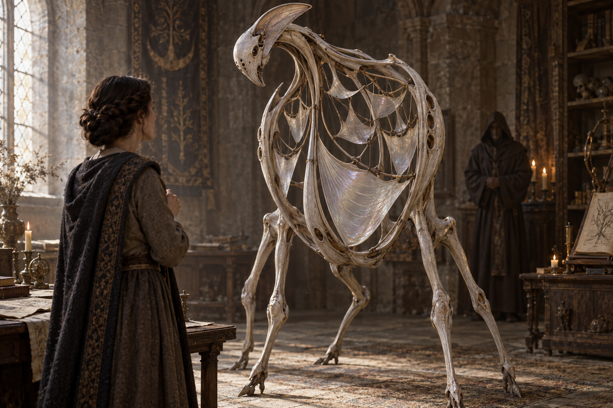

# 💀 Les Remontés

[← Bestiaire](BESTIAIRE.md) · [Regroupements](REGROUPEMENTS.md) · [Mort v1 — les nœuds d'une vie](../magies/MORT_V1.md) · [Le sillon et l'excédent](../magies/ANNULATION_V1.md)

## 📌 Statut

Fiche refondue sur la physique de [Mort v1](../magies/MORT_V1.md).

> **Décision retenue : un Remonté est un rassemblement qui ne s'est pas refermé et qui a fini par tenir seul.**

Il ne contient aucune âme, ne porte aucune trace « en lui » et n'a hérité de rien. Ce qui tient, c'est **l'appel** — l'opération elle-même, devenue capable de se poursuivre sans personne pour la conduire. C'est la condition ordinaire de naissance des Non-Vivants, appliquée à un rite : une opération tenue ou répétée assez longtemps pour que sa continuité cesse de dépendre de ceux qui l'assuraient ([MONDE.md](../MONDE.md#-origine-des-non-vivants)).

**Sur le nom.** Les vivants disent *Remontés* comme on dit revenants, et ils se trompent : personne n'est remonté. Ce qui remonte, ce sont des fragments — c'est le mot même du rite, et il ne désigne aucune personne. Les ordres funéraires disent *un appel sans congé* ; ils n'ont jamais réussi à imposer leur formule.

Anatomie, croissance et effets de voisinage sont des propositions. Reproduction, alimentation réelle, durée de persistance et conditions exactes du seuil restent ouvertes.

## 👁️ Proposition visuelle

[Image complète](../visuels/remontes-v1.png) · [Prompt de génération](../visuels/remontes-v1-prompt.md)

La silhouette reste celle d'une créature étrangère. Les personnes représentées illustrent une consultation ; aucune biographie ni chronologie ne leur est attribuée.

## 🌱 Deux naissances

**Après rituel — la voie connue.** Une chapelle, un caveau, une arrière-salle où l'on rappelle le même mort, au même endroit, avec les mêmes objets, depuis des années. Chaque séance approfondit le sillon de l'appel lui-même. Un congé bâclé, un congé tardif, ou simplement la répétition : un jour le rassemblement se refait sans qu'on l'ait demandé, puis ne se défait plus.

C'est la naissance que les ordres funéraires redoutent, et celle qu'un mage retourné peut fabriquer exprès s'il accepte d'y passer des années.

**Spontanément — la voie que personne ne surveille.** Aucun rite, aucun initié. Une famille qui parle de son mort chaque jour à la même table. Un atelier où l'on dit encore *le vieux faisait comme ça* en refaisant le geste. Une tombe visitée sans faute. **Les vivants rassemblent sans le savoir**, par le nom répété et les objets gardés en place — exactement ce que la liturgie fait délibérément.

C'est la naissance la plus fréquente selon cette version, et la seule qui explique des Remontés dans des endroits où nul n'a jamais pratiqué.

## 🧩 Un corps qui est un vase

Le torse forme une cage portée par des membres minces. À l'intérieur, des membranes vocales de tailles différentes sont tendues entre des arcs souples. Plusieurs ouvertures laissent sortir les sons.

**Cette anatomie est celle d'un récepteur.** Le rite pose une coupe pour que ce qui remonte ait où se déposer ; ici le récepteur a pris corps et ne se vide plus. Les membranes ne sont pas des personnes miniatures ni des âmes retenues : ce sont les surfaces où le rassemblement se dépose et redevient audible.

| Partie du corps | Fonction proposée |
|---|---|
| Cage et arcs souples | Tiennent le rassemblement ouvert, comme une coupe qu'on ne retourne jamais. |
| Membranes vocales | Rendent perceptible ce que l'appel ramène ; leur tension varie avec ce qui remonte. |
| Ouvertures vocales | Laissent sortir la voix depuis plusieurs points — plusieurs nœuds répondent à la fois. |
| Membres et articulations | Refont les gestes usés que les nœuds portent, dans les limites de son anatomie. |

Leur nombre ne fixe celui d'aucun défunt.

## 🗣️ Instinct : continuer d'appeler

Le Remonté ne conserve rien et ne se souvient de rien. **Il rassemble, en permanence, ce qui porte les noms qu'on prononce devant lui** — et il rend ce qui remonte.

D'où trois comportements, qui sont les propriétés du rite et non d'une personne :

- **Il répond au nom**, à la formule, à l'épisode raconté — parce que ce sont exactement les manœuvres qui rassemblent.
- **Il ramène du bruit avec le signal.** Homonymes, compagnons de lieu, compagnons d'objet : tout ce qui partage l'étiquette entre dans le rassemblement. Une voix peut accompagner le geste d'une autre vie, et une phrase que personne n'a jamais dite peut se composer de deux morts.
- **Il rend ce qu'on vient de lui donner.** Ce qu'un visiteur dit à voix haute devient un nœud frais et très proche, qui remonte ensuite comme s'il venait du défunt. **Plus on l'aide en racontant, plus il restitue le récit du visiteur.**

## 📈 Il grandit d'être consulté

C'est la propriété la plus importante de cette version, et le piège qu'elle installe.

Chaque consultation apporte des noms, des objets, des récits, et creuse un peu plus le sillon de l'appel. **Un Remonté souvent consulté devient donc à la fois plus convaincant et plus pollué** : ses réponses gagnent en détail et perdent en provenance. Il ne se dégrade pas avec le temps — il se dégrade avec le succès.

Trier, stabiliser ou retirer ce qu'il rassemble n'est pas une technique acquise, et cette version rend la chose douteuse en principe : on ne trie pas un rassemblement, on ne peut que changer ce qui est à portée.

## 🌫️ Ce qu'il fait au voisinage

**Un Remonté est un récepteur ouvert, et il prend le dépôt des autres.**

Les rites conduits à sa portée tournent mal : ce qui devait se déposer dans la coupe d'un initié se dépose en partie chez lui, et ressort plus tard, ailleurs, dans une autre consultation. Un village qui abrite un Remonté a une nécromancie peu fiable sans savoir pourquoi — et ses praticiens **prennent la voix** moins souvent, ce qui passe pour de la chance.

C'est aussi ce qui rend l'espèce précieuse pour qui la comprend : on installe un Remonté là où l'on veut savoir ce que les autres demandent à leurs morts.

## ⚖️ Reconnaissance et fiabilité

- Une voix fidèle n'est pas une présence : rien n'a jamais été quelqu'un.
- Une information produite est une piste, jamais une preuve — et elle peut venir du visiteur lui-même.
- La sincérité de qui reconnaît un geste ne garantit la fidélité de rien.
- Une imitation cohérente peut se défaire d'un coup quand un autre nœud entre dans le rassemblement.
- Produire des paroles convaincantes ne constitue ni conseil, ni négociation, ni tromperie délibérée. **La créature ne ment pas : elle rend ce qu'on a rassemblé.**
- L'émotion des visiteurs appartient à leur réaction humaine ; aucun pouvoir d'Émotions ou d'Illusions n'est ajouté.

## 🗝️ Exemple proposé : l'acte caché

Une héritière vient consulter un Remonté auprès d'un mage retourné. Elle cherche un acte que son père aurait caché.

Elle prononce son nom. Dans la cage thoracique, une membrane grave se tend. La créature incline la tête et dit :

> Tu fermes toujours les volets trop tôt.

C'est exactement ce que son père lui reprochait enfant — et c'est le nœud le plus profond de cette vie-là, celui d'un geste repris mille fois au même seuil.

Elle demande où se trouve l'acte. La créature répète quelques mots sur une pièce froide et un coffre. Le retourné lui fait décrire la maison **pour provoquer d'autres associations** : elle raconte le corridor, l'odeur du charbon, la porte qui gonflait l'hiver.

Puis le Remonté l'appelle par le prénom d'une autre femme. La voix est toujours celle du père ; le geste qui l'accompagne appartient à une autre vie.

Ce que l'héritière ne peut pas savoir : **la pièce froide est peut-être celle qu'elle vient de décrire.** Tout ce qu'elle a dit à voix haute est entré dans le rassemblement, et lui revient maintenant par la même bouche. Le retourné, lui, le sait très bien.

Cette scène ne fixe ni l'existence de l'acte ni son emplacement.

## 🧙 Supervision par un retourné

**On ne dirige pas un Remonté : on meuble la pièce.** Le superviseur choisit quels objets sont présents, quels noms peuvent être prononcés, qui entre et ce qu'on lui laisse raconter. Son art n'est pas la liturgie, c'est le rangement.

- Il retire les objets qui apportent des vies parasites, et garde ceux qui portent la vie qu'il vend.
- Il interdit certains noms dans la salle, parce qu'il sait ce qu'ils rassembleraient.
- Il fait parler les visiteurs avant la consultation, et récolte ce qui ressortira.

Il obtient ainsi des indices et une emprise considérable sur ceux qui viennent entendre leurs morts. Ce choix lui appartient : la créature n'élabore aucune tromperie et ne comprend aucune mission.

## 🕳️ Ce qu'on peut faire contre

- **Vider la pièce.** Retirer les objets, disperser les lieux, taire le nom : c'est effacer le mort pour éteindre la créature, et cela se paie sur les vivants qui lui tenaient.
- **Interrompre.** Un annulateur peut trancher — mais couper ne supprime pas la charge, elle la rend au lieu. Un Remonté installé depuis des années reprenait peut-être le dépôt de tous les rites du canton. **Personne ne sait ce qu'il absorbait avant de l'avoir retiré.**
- **Cesser de consulter.** La seule mesure qui ne coûte rien, et la seule que personne ne tient : un Remonté qu'on ne nourrit plus de noms s'appauvrit. Combien de temps, et jusqu'où, reste ouvert.

## 🕸️ Associations

- **Assemblées de traces :** les Retours de regard apportent des indices ; les Mnémophages travaillent les mémoires vivantes ; les Remontés rendent audible ce que le nom rassemble. Ce que ces familles se passent réellement reste à définir — mais toutes trois vivent dans des réseaux de mémoire, et se nourrissent là où l'on cherche.
- **Veilles :** les paroles d'un Remonté poussent les humains à rouvrir des affaires. Les Antérieurs se rencontrent par l'observation du passé ; le Remonté ne certifie rien et ne modifie rien.

## ❓ Paramètres ouverts

Seuil exact à partir duquel un rassemblement tient seul ; durée de persistance sans consultation ; reproduction ; alimentation réelle et ressources de croissance ; portée du voisinage où il capte le dépôt des autres ; possibilité de lire ou d'interrompre son propre sillon ; conditions dans lesquelles un Remonté né spontanément se distingue d'un Remonté fabriqué. Aucun coût ni durée chiffrés ne sont fixés.

**Une créature étrangère accomplit soudain le petit geste par lequel vous reconnaissiez votre père — et vous ne saurez jamais si vous le lui avez donné vous-même.**
