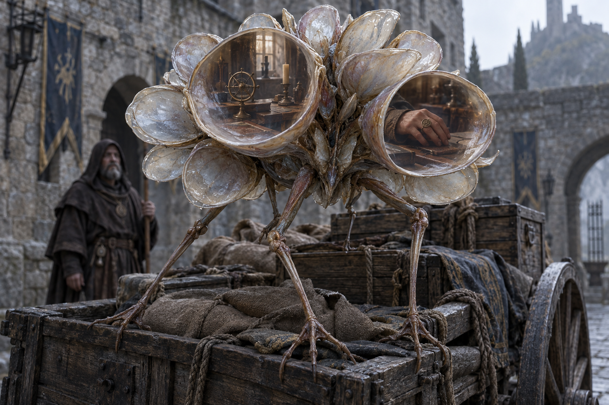

# 🔍 Les Retours de regard

[← Bestiaire](BESTIAIRE.md) · [Regroupements](REGROUPEMENTS.md) · [Divination humaine](../MAGIES_ET_RELATIONS.md)

## 📌 Statut

Développement issu de la discussion, enregistré à la suite du « go » de l’utilisateur. **Le lien utilisé pour observer un Retour de regard lui permet de percevoir quelque chose de l’observateur.** La proposition lui donne des coupelles sensorielles qui rendent certains fragments perceptibles à proximité de son corps.

Anatomie, comportement et exemple ci-dessous développent ce principe. Conditions particulières de naissance, reproduction, alimentation, liens recevables, netteté et conservation des impressions restent ouverts. La Divination humaine n’a pas encore de grammaire détaillée équivalente aux v1 des autres écoles.

## 👁️ Proposition visuelle

[Image complète](../visuels/retour-de-regard-v1.png) · [Prompt de génération](../visuels/retour-de-regard-v1-prompt.md)

La clarté des fragments et la forme de l’instrument représenté sont illustratives. La figure humaine est un superviseur anonyme, sans biographie établie.

## 🧩 Un corps qui recueille les regards

L’animal est ramassé, perché sur de longues pattes fines. Son corps porte des coupelles translucides repliées les unes contre les autres au repos.

Lorsqu’une recherche divinatoire le touche, une coupelle se déploie et s’oriente. Sa surface se trouble ; une impression fragmentaire peut y apparaître, issue de l’autre extrémité du lien.

| Partie du corps | Fonction proposée |
|---|---|
| Pattes fines | Permettent de se placer et de se dégager dans le milieu observé. |
| Coupelles repliables | Recueillent les contacts divinatoires et orientent la perception de la créature. |
| Surfaces translucides | Rendent perceptibles des fragments reçus par le lien inverse. |
| Articulations des coupelles | Déploient ou referment les organes selon les stimulations. |

Ces surfaces sont des organes de la créature. Leur fonctionnement n’exige ni commande comprise ni autorisation d’un praticien.

## 🔗 Une perception par le lien inverse

Le Retour de regard exploite un lien divinatoire qui l’atteint. Il ne choisit pas librement une personne inconnue à observer depuis sa cachette.

Les impressions peuvent montrer un mouvement, une surface proche ou une silhouette. Leur contenu dépend de ce que le lien permet réellement de percevoir. Un fragment ne fournit pas automatiquement l’identité, les pensées, la localisation exacte ou l’environnement complet du devin.

La proposition rend ces impressions visibles sur les coupelles. Un humain placé près de la créature peut les regarder et les interpréter ; il ne reçoit pas une révélation télépathique.

Voir n’est pas garantir la vérité. Une bague peut être empruntée, un détail mal interprété, une apparence trompeuse. La créature ne certifie pas les conclusions de son superviseur.

## 🔄 Instinct : prolonger le contact

Le Retour de regard s’oriente vers les liens qui l’atteignent. Il cherche à rester observable : se dégager d’un obstacle, déployer ses coupelles ou revenir vers un emplacement où il a été recherché.

Ces réactions ne supposent pas qu’il comprenne le métier ou les intentions de l’observateur. Plus on l’examine, plus on lui offre d’occasions de percevoir en retour, sans garantie d’obtenir des informations nouvelles à chaque contact.

L’alimentation et le bénéfice exact de ces contacts restent à définir. L’attention reçue n’est pas déclarée source gratuite d’énergie. L’existence d’objets chargés dans la pratique humaine ne prouve pas que les coupelles constituent des réserves équivalentes.

## 🛒 Exemple proposé : le chariot disparu

Une devineresse recherche un chariot disparu à partir d’un fragment de son essieu. Ce lien est une hypothèse de scène : les catégories de liens recevables en Divination restent à définir.

Elle aperçoit le chariot dans une cour abandonnée. Sur le chargement repose une créature dont les coupelles se déploient une à une.

Dans l’une d’elles apparaît le bord de la table où la devineresse a posé son instrument. Elle rapproche son observation pour comprendre. Une autre coupelle laisse voir sa main.

Derrière la créature, un retourné attend. Il regarde les surfaces et interprète ce qu’elles montrent. Il croit reconnaître sur la main une bague portée par les enquêteurs du Collège.

La devineresse coupe sa recherche. Les images se brouillent. Le retourné dispose d’un indice reliant l’enquête au Collège, sans certitude absolue sur l’identité de l’enquêtrice ni sur sa localisation.

La bague est un détail proposé pour cet exemple, pas un insigne institutionnel établi. Le brouillage après coupure ne fixe pas encore une durée universelle d’effacement des impressions.

## 🧙 Supervision par un retourné

Le superviseur place la créature près d’un objet susceptible d’être recherché, puis observe ses réactions et ses coupelles. Il peut ainsi détecter certaines enquêtes et recueillir des indices sur leurs auteurs.

Il doit rester présent ou organiser des témoins pour interpréter les impressions. Aucun enregistrement durable, aucune alerte mentale ni transmission distante ne lui sont automatiquement accordés.

La créature ne répond pas à la demande abstraite « montre-moi qui me recherche ». Son activité dépend d’un contact effectif, de ses réactions et de limites encore ouvertes. Les méthodes d’attraction et de contention restent à concevoir.

## 🕸️ Associations

- **Assemblées de traces :** les Retours de regard fournissent des indices sur certaines recherches. Les Mnémophages accèdent aux souvenirs par leurs propres mécanismes ; les Remontés produisent des imitations à partir de traces. Une image de coupelle ne donne pas automatiquement accès à la mémoire de la personne montrée.
- **Veilles :** ils peuvent exploiter les recherches divinatoires liées à une enquête sur le passé. Leur présence ne transforme pas chaque observation temporelle en lien de Divination ; les Antérieurs conservent leur mécanisme distinct.
- **Couvées :** un individu peut renseigner le superviseur sur des investigations qui touchent le regroupement, sans devenir un détecteur universel d’ennemis.

## ⚖️ Limites de cette version

Le contact décrit ici est divinatoire. Un regard ordinaire ne déclenche pas automatiquement la même remontée d’information. Son éventuel effet sur le comportement local reste ouvert.

Les images ne sont ni des passages spatiaux ni des copies matérielles. Une main montrée dans une coupelle ne peut pas en sortir. Cette famille ne gagne pas les pouvoirs des Entre-deux, de l’Esprit ou des Illusions.

**Vous regardez une créature lointaine, et sa peau commence à montrer votre chambre.**

## ❓ Paramètres ouverts

Conditions particulières de naissance, reproduction, alimentation, ressources de croissance, liens exploitables, contenu perceptible, résolution, nombre de contacts simultanés, portée, conservation des impressions, réactions à la coupure, reconnaissance d’un contact répété et moyens de supervision. Aucun coût ni durée chiffrés ne sont fixés.
