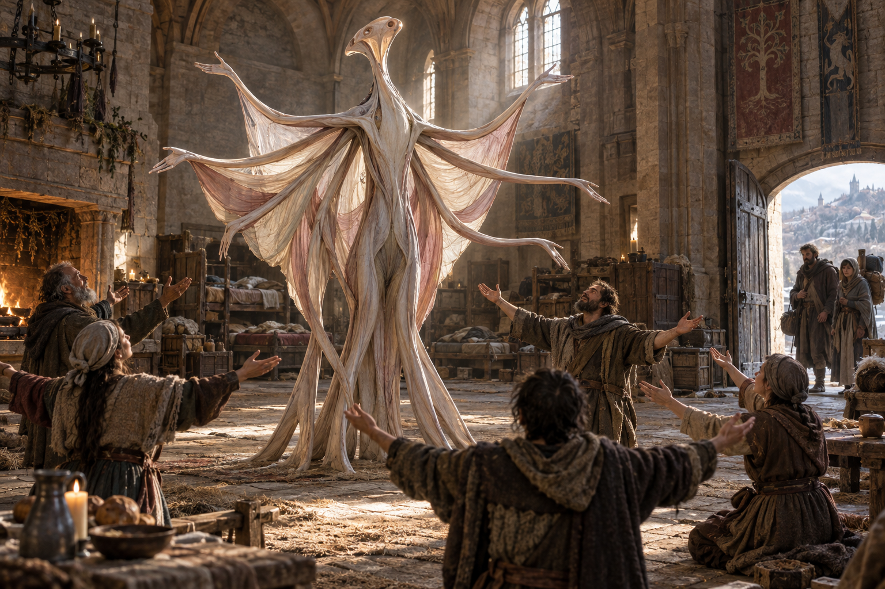

# ❤️ Les Saints affamés

[← Bestiaire](BESTIAIRE.md) · [Regroupements](REGROUPEMENTS.md) · [Magie des Émotions](../MAGIES_ET_RELATIONS.md)

## 📌 Statut

Développement issu de la discussion, enregistré à la suite du « go » de l’utilisateur. **Le Saint dépend d’une croyance partagée qu’il entretient instinctivement, sans croire lui-même.** Son corps reprend les gestes et la danse de la magie des Émotions.

L’anatomie, les réactions et la scène ci-dessous développent la proposition. Conditions particulières de naissance, reproduction, alimentation précise et performances restent ouvertes. Le Saint ne possède ni personnalité consciente ni projet politique.

## 👁️ Proposition visuelle

[Image complète](../visuels/saint-affame-v1.png) · [Prompt de génération](../visuels/saint-affame-v1-prompt.md)

Les habitants reprennent un mouvement collectif. La posture ne prouve ni adhésion forcée ni contrôle mental. La silhouette et l’échelle sont illustratives.

## 🧩 Un corps autour duquel on se rassemble

La créature est dressée sur un tronc souple, entouré de bras en éventail et de membranes plissées. Ses membres se déploient lentement puis reviennent contre son corps selon des séquences répétées.

Les humains peuvent reprendre ces mouvements : ouvrir les mains, se rapprocher, s’incliner et se relever ensemble. Le Saint ajuste son rythme aux réactions du groupe.

| Partie ou mouvement | Fonction proposée |
|---|---|
| Tronc souple | Porte et accompagne les changements de posture. |
| Bras en éventail | Produisent des gestes visibles que les participants peuvent reprendre. |
| Membranes plissées | Rendent les déploiements et rythmes corporels perceptibles dans le rassemblement. |
| Séquences répétées | Soutiennent la coordination et les émotions associées à la conviction commune. |

Son allure peut évoquer une figure sacrée sans visage humain. Le nom de « Saint » vient des humains ; il n’établit ni divinité ni religion universelle.

## 🔄 Instinct : entretenir l’accord

Le Saint réagit à un rassemblement où une conviction commune existe déjà. Ses mouvements soutiennent les émotions liées à cette conviction : soulagement, confiance, courage ou ferveur.

Il reproduit les séquences qui maintiennent l’engagement collectif. Cette adaptation instinctive ne signifie pas qu’il comprend le récit partagé ou décide d’une doctrine.

Il ne fabrique pas librement une croyance chez des inconnus. L’émotion renforcée ne fournit pas une idée précise et ne force pas automatiquement une action.

## 🙏 Croyance humaine et créature instinctive

Chez le praticien humain, la croyance doit être partagée entre le mage et les personnes touchées. Dans cette proposition de Non-Vivant, **la communauté porte la croyance ; la créature en dépend et l’entretient sans y adhérer consciemment**.

Cette particularité de créature ne change pas l’accès ni les conditions de pratique des mages humains. La manière exacte dont le Saint perçoit la cohésion et dont celle-ci soutient son existence reste à développer.

Sa « faim » désigne cette dépendance, sans fixer une conversion gratuite de croyance en énergie physique. Alimentation réelle, ressources de croissance et survie hors d’un rassemblement restent ouvertes.

## 🏠 Exemple proposé : le rassemblement du refuge

Chaque soir, les habitants d’un refuge se réunissent autour d’un Saint. Leur conviction commune est :

> Tant que nous restons ensemble, nous pouvons traverser cette épreuve.

La créature écarte ses bras. Les habitants reprennent le geste. Leurs mouvements se synchronisent ; leur peur diminue assez pour qu’ils retournent soigner les blessés et réparer les portes.

Cette aide émotionnelle ne soigne pas les plaies et ne répare pas le bâtiment. Elle aide des personnes à reprendre ces tâches avec les moyens disponibles.

Puis des familles décident de partir vers un refuge mieux approvisionné. À leur départ, le rassemblement se défait. Le Saint répète les mouvements qui ramenaient les participants les uns vers les autres. Chez ceux qui partagent encore la conviction, l’attachement au groupe devient plus intense.

La créature ne condamne personne. Ce sont les habitants qui commencent à appeler les départs des abandons. Ce jugement est une réaction humaine possible, pas une pensée précise implantée par la créature.

Le retourné qui conduit les cérémonies peut faciliter la séparation, ou présenter la détresse collective comme une preuve qu’il faut interdire les départs. Le choix politique et ses conséquences lui appartiennent.

Cette scène est un exemple de conception ; elle n’établit pas un événement historique ni une réaction identique dans tous les groupes.

## 🧙 Supervision par un retourné

Le superviseur réunit les participants, organise les cérémonies et choisit les récits autour desquels ils se retrouvent. Il observe les réactions du Saint et de la communauté pour entretenir leur association.

Il obtient un soutien émotionnel collectif susceptible de durer au-delà de sa propre intervention directe. Cette puissance dépend toujours de la participation et d’une conviction effectivement partagée.

Il peut aider à préserver la confiance ou transformer le rassemblement en obligation sociale. La créature ne définit pas elle-même les admissions, les sanctions ou les règles du refuge.

## ⚖️ Utilité et danger

L’aide peut être réelle : retrouver du courage, supporter une épreuve, continuer une œuvre commune. Mais maintenir cette aide peut devenir une obligation de participer et de ressentir avec les autres.

- Les personnes qui ne partagent plus la croyance ne sont pas automatiquement ramenées à l’adhésion.
- La synchronisation gestuelle ne suffit pas à prouver une conviction sincère.
- L’apaisement ne supprime pas les causes matérielles d’un danger.
- Le Saint ne bloque pas physiquement les sorties par cette seule capacité.
- Aucune guérison, lecture de pensée, illusion ou matérialisation d’émotion n’est ajoutée.
- La perte de croyance et la dispersion peuvent fragiliser l’association ; leurs effets corporels précis restent ouverts.

## 🕸️ Dans les Couvées

L’Enclos fournit une fermeture matérielle ; les Peaux de peur suscitent des apparences liées à l’inquiétude ; le Saint entretient les émotions associées à la conviction protectrice du groupe.

Leur complémentarité n’est pas assurée. Trop de terreur peut détruire la confiance ; une fermeture vécue comme une captivité peut ébranler la croyance en la protection. Le superviseur doit entretenir les conditions de l’association, sans conscience collective attribuée aux créatures.

## ❓ Paramètres ouverts

Conditions particulières de naissance, reproduction, alimentation, ressources de croissance, perception de la croyance commune, amplitude des effets, diversité des convictions compatibles, durée hors rassemblement, réactions à la rupture de confiance et moyens de supervision. Aucun coût ni seuil chiffré n’est fixé.

**Une créature ouvre ses bras, toute une salle respire ensemble, et personne ne veut être le premier à sortir.**
