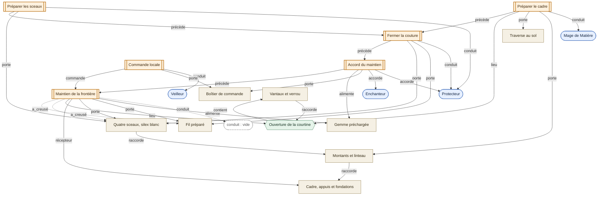

# 🕸️ La Porte cousue — graphe de construction

[← Fiche de l’ouvrage](BASTION_PORTE_COUSUE_V1.md) · [Bastion](01-bastion.md)

Essai d’encodage de la [recette v1](BASTION_PORTE_COUSUE_V1.md) dans l’ontologie du moteur. Aucune valeur chiffrée n’est introduite.

## 🔤 Légende

| Forme | Type | |
|---|---|---|
| `([ ])` | **Actor** | Personnes, équipes, créatures |
| `[ ]` | **Thing** | Supports, substances, réserves |
| `{{ }}` | **Space** | Lieux et ouvertures |
| `[[ ]]` | **Narrative** | Une opération réifiée |

Traits pleins : rôles et composition. Traits pointillés : rôle non rempli et sillon déposé.

Seuls scalaires, non représentés : `profondeur`, `charge`, `capacité`.

**Aucun Moment.** Une recette n’en contient pas : elle porte un ordre (`précède`) et des conditions. Un Moment est un instant ou un intervalle que **plus d’un Narrative** peut désigner ; il apparaît à l’instanciation, pas ici.

## 📌 Points de lecture

- **`conduit : vide` sur « Maintien de la frontière »** est l’objet même de l’ouvrage : l’Enchantement sert à faire tourner une opération sans conducteur présent. C’est aussi l’emplacement qu’un Non-Vivant remplirait.
- **Le lien créateur↔création** est le chemin conservé `AP ←accorde— N4 —porte→ TB`, et `AM ←conduit— N1 —porte→ TC`. Il persiste après le départ des praticiens et ne conduit ni ordre ni puissance.
- **La règle de défaillance de la recette** — perdre un sceau rend le contour entier inactif — se lit comme la dépendance de `N5` à `TS` : aucun chemin de repli vers un contour à trois ancrages.
- **`TV` n’est rattaché à aucun Narrative.** Les vantaux sont l’obstacle non magique qui subsiste quand `TG` est épuisée.
- **La transmission des efforts n’est pas un Narrative.** La poussée arrêtée circule le long des liens `raccorde` entre Things, `TS → TC → TFO`. Seule la frontière est magique ; ce qu’elle transmet est mécanique.

## ⚖️ Ce que ce graphe montre, et ce qu’il ne montre pas

Il ne révèle **aucune propriété de la Porte cousue** que la [fiche](BASTION_PORTE_COUSUE_V1.md) ne dise déjà. Sa valeur est de vérifier que l’ontologie encaisse une recette entière sans perte, et de rendre les invariants vérifiables : deux `accorde` distincts, un `alimente` réel, un `récepteur` identifié.

**Une recette isolée ne peut rien faire émerger.** L’émergence demande que plusieurs recettes partagent un même Thing — un dissipateur, un étalon, un carrefour. C’est une scène instanciée qu’il faut grapher pour voir naître quelque chose, pas un ouvrage.
