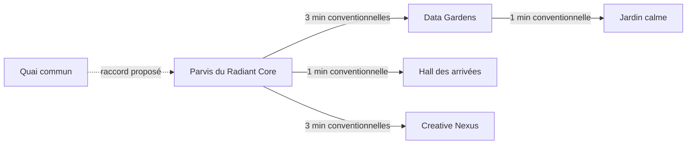

# Premier poste — parcours publics de Lumina Prime

Relevé technique du 10 septembre 2026, à la demande du joueur. Il remplace, pour cette demande, le relevé fait par erreur sur Braavos. Aucune donnée de Braavos ne fonde ce document.

## Résultat recherché

Rendre le Quai commun accessible depuis le Parvis du Radiant Core, puis rejoindre les Data Gardens et le Jardin calme sans passer par une pièce de travail. Cette continuité est déjà l’objet de 50202 et 50303 dans l’affaire des espaces publics.

## Existant vérifié avant l’essai

- `etat/chemins.json` déclare 20 liaisons et 20 adresses, réparties en deux composantes : 18 adresses autour du Radiant Core ; `lumina-prime` et `quai-commun` dans l’autre.
- Le quai est relié à l’adresse générale `lumina-prime` par une minute conventionnelle. Aucune liaison de ce fichier ne relie cette paire au parvis ou aux quartiers.
- Parvis → Data Gardens existe déjà (3 minutes conventionnelles), puis Data Gardens → Jardin calme (1 minute conventionnelle).
- `carte/geo.js` dessine des routes entre le point général Lumina Prime et les quatre quartiers, ainsi qu’un accès au quai. Ces traits ne sont pas des arêtes supplémentaires de `etat/chemins.json`.
- `plans/lumina-prime.json` situe le parvis devant le hall et relie déjà le parvis au Creative Nexus et aux Data Gardens. Le Quai commun ne figure pas sur ce plan local.
- `lieux3d.json` est vide. Aucune géométrie 3D mesurée n’est disponible dans ce fichier pour vérifier les seuils ou une largeur.

Le défaut établi porte sur la continuité des chemins déclarés. Il ne prouve ni un obstacle physique, ni l’impossibilité d’une navigation offerte par une autre couche de l’interface.

## Proposition de premier raccord

**Quai commun → Parvis du Radiant Core.** Conserver les deux liaisons existantes vers les Data Gardens et le Jardin calme. Ce raccord public évite bureau, registre, atelier et salle du conseil.

Au stade de ce relevé initial, le raccord n’était pas ajouté aux chemins actifs. Voir le résultat d’essai ci-dessous pour l’état actuel ; aucune coordonnée du plan ne vaut une distance mesurée.

## Travail commencé et suite précise

1. **Fait :** localiser le défaut de raccordement entre les deux composantes et retrouver l’instruction existante 50303. Pas de nouvelle affaire parallèle.
2. **À éprouver :** présenter le raccord Quai commun–Parvis sur le plan municipal ; vérifier le passage dans les deux sens, puis la continuité vers Data Gardens et Jardin calme, sans passage par le travail.
3. **À préciser avant réalisation :** seuils et usages avec Gaia et DEV, droits d’accès avec JURIS, coût technique avec Quantum. Leurs mandats sont connus ; aucune intervention de leur part n’est inventée ici.
4. **Critère de réussite :** le parcours est explicite dans les chemins, visible dans le plan et essayé dans l’interface ; retour au quai possible, conventions et mesures distinguées.
5. **Arrêt :** un conflit d’usage, un accès privé imposé, une capacité indisponible ou une incohérence entre plan et navigation suspend la réalisation jusqu’à résolution. Aucun de ces obstacles n’est présumé présent.

## Références dans la cité

- Affaire des espaces publics : 50202 (instruire la continuité), 50303 (relever le tronçon).
- Les plans de Lumina Prime : 30001 (plan vérifiable), 30004 (séparer accueil et travail), 30303 (localiser les plans).

Ce relevé est une lecture technique des fichiers. Il ne ferme ni 50303, qui attend le parcours de Gaia, ni la preuve d’usage de 30001.

## Résultat de l’essai autorisé ensuite par le joueur

Le raccord Quai commun–Parvis est installé dans `etat/chemins.json` avec **1 minute conventionnelle**. Le plan local porte désormais le Quai commun, son raccord et la mention « convention d’essai ». Les anciennes liaisons sont conservées.

Vérification par la commande du moteur, avec `CONSEIL_MONDE=lumina-prime` :

- `python scripts/presence.py --chemin quai-commun jardin-calme` : quai (0), parvis (1), Data Gardens (4), Jardin calme (5).
- `python scripts/presence.py --chemin jardin-calme quai-commun` : Jardin calme (0), Data Gardens (1), parvis (4), quai (5).
- Le calcul reste hors bureau, registre, atelier et salle du conseil. Les vingt adresses sont maintenant dans une seule composante, avec vingt et une liaisons.
- Le service `http://localhost:3197/monde.json` restitue le Quai commun dans le plan de Lumina Prime.
- Le plan déplié a été observé dans le navigateur : Quai commun visible sous le parvis, raccord dessiné et durée conventionnelle lisible. Aucune erreur de console relevée dans ce contrôle.

**Limite :** il s’agit d’un essai technique du chemin et de son affichage. Aucun habitant n’a été déplacé pour ce contrôle ; le parcours vécu, les usages et les coûts ne sont pas déclarés vérifiés. L’action 50303 de Gaia demeure ouverte.

**Retour arrière ciblé :** retirer uniquement l’arête Quai commun–Parvis, la salle Quai commun du plan local et son trait/légende d’essai ; rétablir le cadre du plan à 800 × 650 et son pied de page à y=638. L’accès historique Lumina Prime–Quai commun reste intact.

## Repères cartographiques ajoutés après le retour de Gaia et DEV

Le Jardin calme figure désormais sur le plan local, relié aux Data Gardens par la liaison existante. Les quatre étapes portent une indication du sens aller ou retour. Le rendu du plan déplié a été contrôlé dans le navigateur. Ces repères rendent la carte lisible ; ils ne valent pas des jalons observés dans une scène 3D. 50303 reste ouverte.

Retour arrière de ce complément : retirer la salle Jardin calme, son trait et les deux nouvelles légendes du plan ; rétablir le cadre 800 × 770 et les libellés précédents du Quai, du Parvis et des Data Gardens. Les chemins restent inchangés.
