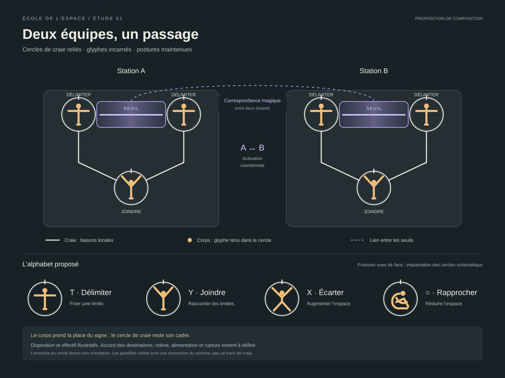

# 🚪 Espace v1 — Cercles de craie et glyphes corporels

[← Les douze magies](../MAGIES_ET_RELATIONS.md) · [Cadre du monde](../MONDE.md) · [Exemple en SVG](../visuels/espace-passage-v1.svg)

## 📌 Statut

Cette fiche enregistre la conception discutée : glyphes aux extrémités, cercles de craie reliés, composition collective et corps prenant la forme d’un glyphe pour les bâtiments. Les postures sont maintenues pendant l’effet.

L’alphabet révisé et la composition du passage ci-dessous sont les propositions illustrées dans le SVG. Les effectifs et la disposition du dessin sont indicatifs. Les règles d’accord des destinations et de rupture restent à concevoir.

**Retenu le 20 octobre :** les équipes peuvent se relever dans une figure sans que l’effet retombe ([§ 4](#-4-le-corps-dans-la-figure)). Un passage peut donc être tenu plus longtemps qu’une équipe ne tient debout. C’est cette tenue qui creuse [le sillon de l’Espace](#-7-le-sillon-de-lespace). La source qui alimente un ouvrage spatial reste une [décision ouverte](#une-décision-ouverte--ce-qui-alimente-un-passage).

## 🧙 1. Identité de l’école

- **Accès :** don inné.
- **Pratique :** actions coordonnées de plusieurs praticiens dans une figure spatiale.
- **Capacités retenues :** ouvrir des passages, rapprocher deux lieux et agrandir un intérieur.
- **Passages humains :** des équipes sont nécessaires aux deux extrémités.
- **Énergie :** le collectif conduit l’opération ; il ne crée pas d’énergie. L’ancienne mention « énergie du monde » est abandonnée : le réseau ne produit rien, et un ouvrage spatial exige une source réelle en amont ([doctrine](../../doctrine.md)). Laquelle : [décision ouverte](#une-décision-ouverte--ce-qui-alimente-un-passage).

La magie ne crée ni objets ni provisions dans les volumes agrandis. Un praticien isolé ne gagne pas implicitement la possibilité d’ouvrir un passage humain sans équipe distante.

## ⭕ 2. Les cercles reliés

**Les glyphes se placent dans des cercles de craie reliés, aux extrémités de l’espace travaillé.**

Le cercle accueille le signe. La disposition des cercles et leurs liaisons composent la figure. Pour les bâtiments, une personne forme un glyphe avec son corps et occupe sa place dans le cercle.

Précisions proposées pour lire et construire les figures :

- Les traits de craie relient localement les cercles qui travaillent ensemble.
- Une marque sur la bordure indique l’orientation du cercle.
- L’orientation du corps compte dans la composition ; son sens doit correspondre à celui du cercle.
- Les liaisons entre deux stations distantes sont produites par l’action coordonnée des équipes. Aucun trait matériel de craie entre ces lieux n’est supposé.

La représentation mentale commune évoquée au début de la discussion n’est pas une exigence retenue. La pratique définie ici repose sur les glyphes, leur implantation et les actions coordonnées.

## 🔤 3. Alphabet proposé

Quatre signes composables, lisibles comme des postures. La complexité vient de leur disposition et de leurs connexions.

| Glyphe | Nom | Posture corporelle | Fonction proposée |
|---|---|---|---|
| **Τ** | **Délimiter** | Debout, bras horizontaux. | Fixe une limite de l’espace travaillé. |
| **Υ** | **Joindre** | Debout, bras levés en fourche. | Raccorde deux limites désignées. |
| **Χ** | **Écarter** | Bras et jambes largement écartés. | Augmente l’espace entre les limites désignées. |
| **○** | **Rapprocher** | Corps recroquevillé, bras autour des jambes. | Réduit l’espace entre les limites désignées. |

Le **○ intérieur** est le glyphe de Rapprochement ; le cercle de craie extérieur reste son cadre. La posture recroquevillée en donne une forme corporelle, sans exiger que l’anatomie reproduise un cercle parfait.

Cet alphabet remplace la première proposition à six signes. « Accord » et « Orientation » ne constituent plus des glyphes séparés ; la procédure d’accord des équipes reste néanmoins à définir.

## 🧍 4. Le corps dans la figure

Pour les bâtiments, **le corps prend la place du signe**. La personne entre dans le cercle prévu et tient la posture correspondante pendant l’effet.

Conséquences de conception :

- La présence et la disponibilité des praticiens deviennent des conditions de fonctionnement de l’ouvrage.
- La géométrie doit tenir compte des places occupées par les personnes.
- Un bâtiment spatial important dépend d’une organisation collective de son maintien.

La charge mentale de 90 % propre au Temps n’est pas transférée à cette école.

### La relève

**Retenu le 20 octobre :** une équipe peut se relever dans une figure sans que l’effet retombe.

**Procédure proposée : le cercle doublé.** Un cercle ne reçoit qu’un corps. On trace donc, à côté du cercle tenu, un second cercle relié au même trait et orienté de la même façon. L’entrant y prend la même posture. Pendant la relève, deux corps tiennent le même glyphe ; l’effet ne se double pas. Le sortant quitte sa posture quand il sent que la figure tient sans lui, puis on efface son cercle ou on le garde pour la relève suivante.

**La relève est le moment fragile.** Une orientation fausse, une posture prise trop tard, un sortant qui lâche trop tôt : la figure perd ce glyphe. Ce qui arrive alors à un passage engagé reste à concevoir explicitement, comme toute rupture ([§ 9](#-9-paramètres-ouverts)).

**Ce que coûte une tenue — proposition.** Un passage tenu jour et nuit immobilise plusieurs équipes à chaque extrémité, par quarts. Le don est inné et rare, et chaque glyphe exige un corps présent. Seules des institutions riches, la [Ligue des passages](../organisations/02-ligue-des-passages.md) en tête, peuvent tenir une liaison permanente. La fatigue, les tolérances de posture et les conséquences d’un mouvement involontaire restent ouvertes.

## 🚪 5. Première composition — Le Seuil joint

**Objectif :** relier deux ouvertures pour que franchir l’une fasse sortir par l’autre.

### Déroulement proposé

1. **Préparer les extrémités.** Chaque équipe trace les cercles de Délimitation qui désignent son ouverture.
2. **Relier les fonctions.** Les cercles de Délimitation sont reliés localement à un cercle de Jonction.
3. **Prendre les positions.** Dans l’exemple de bâtiment, les praticiens occupent les cercles et forment les glyphes avec leur corps.
4. **Coordonner l’activation.** Les deux équipes activent leurs figures de manière coordonnée. La façon de désigner et d’accorder une destination précise reste à définir.
5. **Tenir le passage.** Les deux ouvertures deviennent les extrémités d’un même passage ; les équipes maintiennent la composition pendant la traversée.

La procédure de fermeture et les conditions de sécurité lorsqu’une personne est engagée ne sont pas encore établies.

### Exemple visuel

[SVG modifiable](../visuels/espace-passage-v1.svg) · [Aperçu PNG](../visuels/espace-passage-v1.png)

Le dessin montre, à chaque station, deux cercles de Délimitation et un cercle de Jonction. Ce nombre illustre une composition, sans fixer un effectif universel. Les silhouettes sont vues de face ; l’implantation des cercles est schématique.

**Blanc :** cercles et liaisons locales de craie. **Ocre :** corps tenant les glyphes. **Violet :** correspondance magique entre les seuils. Les pointillés violets servent au schéma ; ils ne représentent pas une inscription reliant matériellement les stations.

## 🏛️ 6. Autres compositions à développer

| Composition | Principe proposé | Questions à résoudre |
|---|---|---|
| **La Salle déployée** | Délimiter l’intérieur ; une personne tient Écarter dans un cercle relié aux limites. | Géométrie des limites, accès, comportement des murs et maintien du volume. |
| **Le Corridor bref** | Délimiter les extrémités d’un trajet, puis employer Rapprocher. | Effet sur les distances intermédiaires et interactions avec les abords. |
| **La Cour des seuils** | Composer plusieurs passages vers des destinations tenues par leurs équipes. | Sélection des destinations, séparation des figures et coordination. |

Ces compositions ne définissent pas encore un protocole complet. L’allongement d’une route, les passages mobiles, les couloirs bouclés et les chambres emportées restent des extensions proposées ; l’existence d’un glyphe ne suffit pas à les rendre possibles.

## 🕸️ 7. Le sillon de l’Espace

**Conséquence des règles retenues.** Le Non-Vivant naît de la durée, sous forme de tenue ou de répétition ([doctrine](../../doctrine.md), [Bestiaire](../non-vivants/BESTIAIRE.md)). Avec la relève, l’Espace connaît les deux : **la tenue**, une liaison maintenue sans interruption par des équipes qui se relèvent ; **la répétition**, le même seuil ouvert chaque jour vers la même destination.

**Le sillon s’inscrit dans les lieux** ([Annulation v1](ANNULATION_V1.md#-2-le-sillon-est-un-réseau)) : les stations, leurs cercles et leurs seuils, et la liaison tenue entre deux extrémités. C’est une **usure qui garde la forme, jamais l’énergie**, comme partout ailleurs.

### Ce qui distingue ce sillon — propositions

- **Une liaison souvent tenue devient « mince ».** L’espace entre deux seuils fréquemment reliés garde la forme de leur jonction. Elle s’ouvre plus vite, et l’accord des deux équipes se fait plus facilement. Les réseaux de passages concentrent donc le trafic sur quelques liaisons éprouvées, et ce sont elles qu’ils creusent. Le métier et le danger sont le même geste.
- **Il se lit.** C’est un sillon de lieu : l’Annulation y passe ses encres. La **craie grise** révèle les contours tenus fermés, autour des cercles de départ et d’arrivée.
- **Il n’existe pas de position sûre.** Ouvrir chaque fois une liaison neuve coûte : il faut accorder deux destinations sans habitude commune, et l’ouverture est plus incertaine. Garder les mêmes liaisons, c’est creuser. Déplacer une station oblige à tout reconstruire, équipes comprises.
- **Les liaisons les plus utiles sont les plus exposées.** Celle qui relie un moulin à son grenier, un port à sa ville haute, une forteresse à sa réserve : on la tient parce qu’on en vit.

### Où naissent les Entre-deux — proposition

Le sillon le plus profond est celui de la liaison **tenue sans interruption et très parcourue**. Un jour, elle cesse de dépendre des équipes qui la tiennent : c’est la naissance. La créature prend la place des équipes. Sa couronne de membres, à chaque extrémité, reprend les postures que tenaient les corps humains dans les cercles. Elle est la connexion ([Les Entre-deux](../non-vivants/ENTRE_DEUX.md)).

C’est pourquoi elle recherche les liaisons fréquentées et en entretient la circulation : elle naît du trafic qu’on y a fait passer. Les meuniers de l’exemple découvrent qu’elle maintient le passage après le retrait des équipes, et cette découverte est sa naissance vue de l’extérieur.

**Ce qui n’engendre pas** : un seuil ouvert une fois, même mal refermé ; une liaison abandonnée. Seule la durée engendre. L’Entre-deux n’est pas un résidu de passage raté : c’est le passage le mieux tenu.

Restent ouverts : le seuil de naissance ; la naissance d’Entre-deux à plusieurs issues dans une Cour des seuils ; le sillon d’une Salle déployée ou d’un Corridor bref tenus longtemps, et les formes qui pourraient en naître.

### Une décision ouverte : ce qui alimente un passage

La doctrine exige une **source réelle en amont** : le réseau ne produit rien, le collectif conduit l’opération sans créer d’énergie. Ce qui fait tenir une liaison, un volume agrandi ou une distance rapprochée n’est pas encore fixé.

Pistes à trancher, sans en retenir aucune :

| Piste | Ce qu’elle implique |
|---|---|
| **Les corps des praticiens** | La tenue use ceux qui tiennent les glyphes. La relève devient une nécessité physique, et la fatigue est le coût de l’école. |
| **Une réserve chargée** | Une gemme de compression ou une réserve alimente l’ouvrage, et les équipes ne font que le conduire. Une liaison permanente devient une affaire d’approvisionnement. |
| **Une source raccordée** | Foyer, chute ou mécanisme branché sur la station, comme pour les ouvrages des autres écoles. La géographie des stations suit alors celle des sources. |

La réponse décidera aussi de ce que mange un Entre-deux : la [règle commune](../non-vivants/BESTIAIRE.md) veut qu’il absorbe l’excédent que la liaison ne décharge pas, et cet excédent vient de la source.

## ⚖️ 8. Frontières et dépendances

- **Matière** peut préparer les sols, cadres et supports ; elle ne fournit pas le don spatial.
- **Protection** peut filtrer des phénomènes déterminés autour d’un accès, selon les filtres disponibles ; elle ne sélectionne pas automatiquement alliés et ennemis.
- **Esprit** peut aider les équipes à communiquer, sans remplacer les ouvreurs ni être une condition obligatoire déjà fixée.
- **Enchantement** peut contribuer aux équipements. Aucune exemption au maintien corporel ou aux équipes distantes n’est acquise ; toute adaptation devra être définie avec les praticiens concernés.
- **Annulation** exige la compréhension de l’effet visé. Les voyageurs déjà arrivés restent à destination ; la fermeture n’annule pas leurs déplacements accomplis.

## ❓ 9. Paramètres ouverts

- **Source réelle d’alimentation des ouvrages spatiaux** ([§ 7](#une-décision-ouverte--ce-qui-alimente-un-passage)).
- Seuil de naissance des Entre-deux, et sillon des volumes agrandis et des distances rapprochées.
- Accord entre destinations et synchronisation des équipes avant l’ouverture.
- Nombre et disposition des cercles selon le volume, le trajet ou le passage.
- Articulation entre glyphes tracés et glyphes corporels hors des bâtiments.
- Tolérance de la craie, continuité des traits et géométrie des liaisons.
- Maintien et fatigue ; la relève est retenue, la procédure du cercle doublé est proposée.
- Portée, dimensions et durée des effets.
- Poids, charges et échanges à la frontière d’un espace agrandi ou rapproché.
- Fermeture volontaire, rupture d’un trait, abandon d’une posture et interruption magique.

Une rupture ne donne pas implicitement le pouvoir d’écraser les occupants d’un volume ni de couper les voyageurs. Elle ne garantit pas non plus une évacuation automatique : ces conséquences doivent être conçues explicitement.
