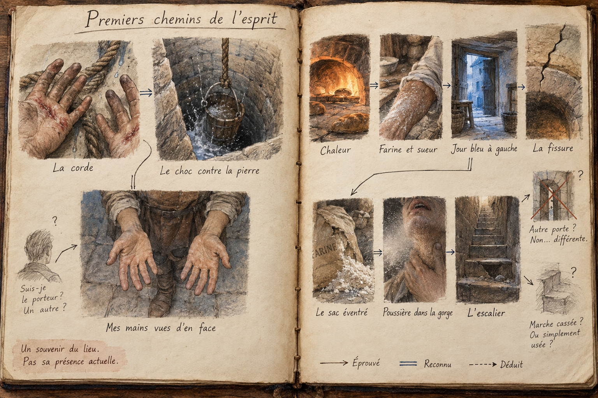
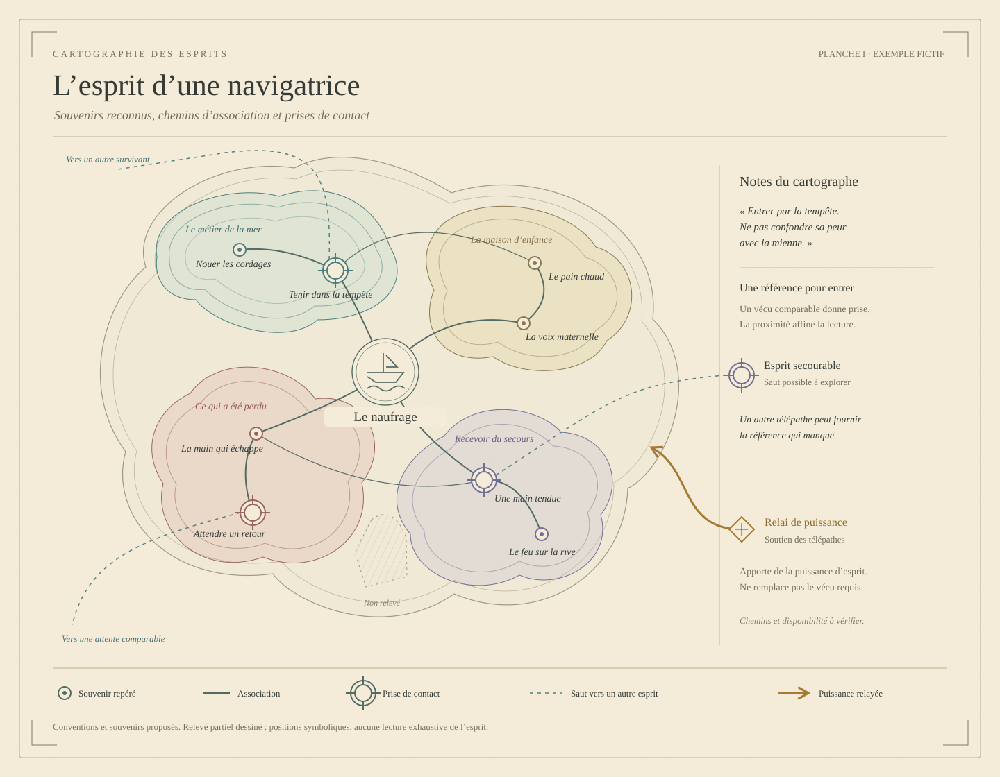

# 🧠 Esprit v1 — Vécus, relais et cartes

[← Les douze magies](../MAGIES_ET_RELATIONS.md) · [Cadre du monde](../MONDE.md) · [Portrait d’esprit en SVG](../visuels/esprit-cartographie-v1.svg)

## 📌 Statut

Cette fiche rassemble la conception de l’école d’Esprit, ses procédures proposées et les développements collectifs discutés.

**Retenu :** référence vécue personnellement, trois opérations fondamentales, précision dépendant de la proximité du vécu, exposition réciproque des contacts profonds et risque de confusion entre ses propres souvenirs et les informations reçues. Le **Relai**, qui donne sa puissance d’esprit aux télépathes, ainsi que les **cartes dessinées du réseau** et les **dessins d’esprits**, sont ajoutés au cadre.

**Retenu le 11 octobre :**

- **Aucune limite de distance physique.** La difficulté n’est pas d’atteindre loin, mais de **naviguer** jusqu’à une personne précise.
- **Le refus n’est accessible qu’à une cible qui comprend ce qui se passe** — par formation, ou parce qu’elle a été contactée à répétition.
- **La pratique impose une charge mentale.**
- **Les institutions du Relai tiennent des cérémonies** qui créent chez leurs membres des points d’ancrage sensoriels communs.

**Retenu le 12 octobre :**

- **Navigation large :** certains esprits sont accessibles par proximité de vécu ; d’autres deviennent accessibles par associations successives. La rencontre préalable de chaque personne n’est pas obligatoire.
- **Point de vue intérieur :** lieux et identités se reconnaissent par les indices des souvenirs traversés. Aucun nom ni position actuelle n’est fourni automatiquement.
- **Cartes :** chaînes de sensations, de situations et de concepts vécus qui permettent d’atteindre une personne ou un souvenir de lieu, ou qui l’ont permis dans le passé.
- **Accès :** faculté humaine éveillable, sans catégorie de personnes exclue. Les conditions de réussite sont exigeantes et encore mal comprises ; aucune méthode ne garantit l’éveil de chacun.
- **Éveil :** maintenir son propre souvenir tout en percevant une autre version du même vécu, sans les confondre. Les proches offrent les premiers contacts les plus reconnaissables.

Les gestes exacts, le passage entre esprits, les conventions cartographiques et les modalités du Relai restent à préciser. L’assistance, la perception par défaut, les endurcis, la forme variable de la charge et les procédures d’initiation restent des **propositions**. Les exemples ci-dessous sont des prototypes de conception, sans biographie ni événement de partie ajoutés.

## 🧙 1. Identité de l’école

- **Accès :** faculté humaine éveillable. L’éveil ouvre la pratique ; la formation aide à la reconnaître et à la maîtriser. L’initiation institutionnelle peut aussi ouvrir un réseau — voir [§ 11](#-11-cérémonies-dancrage). Sa procédure et son efficacité restent proposées.
- **Source :** mémoire du praticien.
- **Pratique :** gestes et postures.
- **Capacités :** recevoir des pensées, explorer des souvenirs, transmettre mentalement et intervenir sur la perception.
- **Réécriture :** modifier durablement un détail d’un souvenir est retenu ; la cible s’en souvient ensuite. Cet usage de Transmettre est distinct de la simple exploration. Changer un élément central et fabriquer un épisode complet restent proposés.

Le mage doit avoir **personnellement vécu quelque chose de comparable pour le reconnaître ou le transmettre**. Une description lue ne lui fournit pas directement l’expérience correspondante.

La biographie détermine donc une partie de la compétence. Un marin, une sage-femme et un ancien prisonnier disposent de références différentes. Voyages, métiers, relations et épreuves peuvent enrichir la formation, sans garantir à eux seuls la maîtrise magique.

### Qui peut s’éveiller, et pourquoi

**Retenu le 12 octobre :** aucune catégorie humaine n’est exclue par naissance ou appartenance. Cela ne signifie pas que chacun réussira : les conditions de l’éveil restent exigeantes et imparfaitement comprises. Aucune lignée réservée ni fréquence chiffrée du don n’est établie.

Habituellement, se souvenir ramène à son propre point de vue. L’éveil consiste à maintenir cette référence tout en percevant une autre version du même vécu et à distinguer les deux sources. Cette seconde perspective devient un accès que le praticien peut apprendre à retrouver. La difficulté de tenir cette double perception explique la rareté de la pratique maîtrisée, sans fixer un nombre de télépathes.

Les premières recherches se tournent naturellement vers les proches : souvenirs communs précis et familiarité rendent les différences reconnaissables. L’affection seule ne suffit pas ; un traumatisme ne garantit rien. Une vie partagée peut ne produire aucun éveil. Des éveils spontanés et des praticiens indépendants restent possibles.

**Déroulement initial proposé :** une réminiscence contient un détail étranger ; une confrontation ultérieure avec le proche permet de vérifier qu’il appartenait à son point de vue. Le novice tente de retrouver ce décalage. Certains perdent la perception ou la prennent pour leur imagination. Ce processus n’est ni une procédure assurée ni une histoire déjà survenue.

## 🪶 2. Précision, profondeur et exposition

### La proximité du vécu

Une ressemblance générale permet un contact grossier ; une expérience proche permet de distinguer davantage de détails. Rencontrer une pensée ne garantit pas d’en saisir le sens.

Le seuil exact de ressemblance reste ouvert : avoir connu la peur n’équivaut pas automatiquement à comprendre l’attente d’une exécution.

### Le risque de confusion

Le mage doit distinguer ce qu’il rappelle, ce qu’il reçoit et ce qu’il interprète. Il peut prendre sa propre blessure pour une information venue de la cible, ou confondre une ressemblance avec une identité. Une lecture sincère peut être erronée.

### L’exposition réciproque

**Un contact profond rend le souvenir de référence du mage perceptible à l’autre.** Pour explorer une fuite, une mage rappelle sa propre évasion. En cherchant les détails chez l’autre, elle peut révéler une personne qui l’a aidée.

Cette exposition porte sur la référence engagée ; elle n’accorde pas automatiquement accès à toute la mémoire du mage. Le contrôle exact de cette exposition reste à définir.

### Perceptibilité et maintien dans le flow

**Principe retenu :** la perceptibilité dépend de ce que le praticien laisse apparaître de sa propre pensée pendant le contact. La maîtrise consiste à rester dans le vécu rencontré, en réduisant commentaires, attentes, peur et associations personnelles ajoutées. La référence nécessaire au passage reste potentiellement perceptible.

**Découpage proposé :** maîtrise du flow rattachée à Naviguer, utilisée aussi pendant Recevoir et Transmettre. La difficulté d’accomplir l’action est distincte de la perceptibilité de cette action. Un novice peut réussir tout en étant repérable ; un expert réduit les traces supplémentaires sans supprimer la référence engagée.

**Moteur de calibration disponible :** [interface et règles du compte](../../../atelier/esprit/README.md). Le compte est tenu séparément pour chaque contact ; retrouver le flow réduit les nouvelles traces mais ne retire pas ce qui a déjà été perçu. Le moteur distingue ressentir un phénomène, reconnaître un contact étranger et identifier l’opérateur — cette dernière opération n’est jamais automatique. Les formules, coefficients, durées et seuils sont expérimentaux. Ils ne déclenchent aucune action de PNJ.

### Recevoir les références actives

**Recevoir permet de percevoir ce que le télépathe mobilise pendant sa traversée** : sensations, souvenirs de référence et associations actuellement suivies. Pratiquer activement l’Esprit rend donc ses propres références plus accessibles à un observateur en contact. Cela étend l’exposition au-delà des seules explorations profondes.

La perception donne un point d’appui, pas l’accès automatique à toute sa mémoire ni la connaissance de son intention ou de sa destination. Explorer un autre souvenir demande une nouvelle passe de Naviguer, puis de Recevoir. Comprendre ce qu’il cherche exige d’interpréter les indices.

Un relais en contact avec l’opérateur peut ainsi observer ce qui passe par lui **s’il est capable de Recevoir**. Fournir de la puissance ne confère pas à lui seul cette compétence. Être relais offre une position d’observation, sans lecture automatique de tous les contacts du réseau. Confier sa pratique à un relais engage donc aussi son intimité.

Le navigateur maintient une référence ouverte pour tenir son chemin. La retirer afin de se protéger peut compromettre la traversée. Les modalités d’une défense simultanée restent à définir ; la charge de la cible ne donne pas, à elle seule, un bonus d’intrusion déjà chiffré.

## 🧭 3. Naviguer — la géographie du vécu

**Retenu :** la distance physique ne limite pas le contact. Un esprit à l’autre bout du monde n’est pas plus difficile à atteindre qu’un esprit dans la même pièce, *si l’on sait comment y aller*.

**Retenu le 12 octobre :** la proximité du vécu rend certains esprits accessibles ; les associations successives permettent d’en atteindre d’autres. Cette navigation large peut être appelée **noosphère**, sans supposer un paysage visible de l’extérieur ni une vue d’ensemble des esprits. L’écart entre vécus guide la difficulté ; aucune métrique exacte n’est fixée.

Un inconnu peut offrir une entrée par une expérience comparable. Un souvenir partagé précis facilite la reconnaissance, sans constituer une garantie d’identité.

### Référence générique et adresse

| Référence | Exemple | Ce qu’elle atteint |
|---|---|---|
| **Générique** | Avoir attendu quelqu’un avec inquiétude | Des correspondances confuses, sans cible identifiée ; entrée possible à affiner. Aucun dénombrement automatique. |
| **Spécifique** | Le moment, vécu ensemble, où le mât s’est rompu | Un chemin plus précis, avec des indices pour reconnaître les participants. |

Plus le vécu est précis, plus les correspondances peuvent être distinguées. Une référence générique ne désigne pas immédiatement quelqu’un ; une exploration peut cependant l’affiner et mener à une personne par étapes. Un concept écrit sur une carte doit renvoyer à une expérience mobilisable, pas agir comme un mot de passe abstrait.

### Les trois chemins vers une personne

1. **Un vécu proche ou un souvenir commun** : entrée possible, à reconnaître.
2. **Une chaîne d’associations et de passages** par des esprits intermédiaires, tracée sur une [carte du réseau](#-15-cartes-dessinées-du-réseau).
3. **Une ancre** reçue lors d’une [cérémonie](#-11-cérémonies-dancrage) à laquelle elle a aussi assisté.

### Conséquence : une vie singulière protège

Une vie singulière peut rendre les correspondances difficiles à trouver ; elle ne garantit pas l’inaccessibilité. Les vécus communs d’une garnison, d’un équipage ou d’un village offrent davantage de chemins candidats, sans donner automatiquement accès à chacun.

### Se situer et identifier depuis le souvenir

**Retenu :** toute reconnaissance est située dans un point de vue. Le mage peut reconnaître visuellement un lieu qu’il connaît ; sinon, fenêtres, lumière, sons, gestes et objets fournissent des indices. Il ne voit pas nécessairement le visage de la personne dont il explore le souvenir. Un nom entendu peut désigner quelqu’un d’autre.

Atteindre le souvenir d’un lieu ne prouve pas que la personne y est actuellement. On peut atteindre le bon bâtiment chez la mauvaise personne, ou la bonne personne dans un lieu ancien. Les souvenirs gardent leurs erreurs et leurs oublis ; plusieurs indices concordants augmentent la confiance sans produire une identité certifiée par la magie.

### Premier trajet conscient — procédure proposée

1. Rappeler une expérience personnelle précise par ses sensations et prendre la posture de Recevoir.
2. Chercher une correspondance ; remarquer les différences qui ne viennent pas de sa propre référence.
3. Stabiliser un point de vue et relever ses indices, sans conclure trop tôt à une identité.
4. Suivre une association dans cet esprit, ou chercher un passage vers un autre vécu correspondant.
5. Vérifier à nouveau les indices après chaque transition et noter les incertitudes.

**Suivre une association interne et passer à un autre esprit sont deux mouvements distincts.** Leur sensation propre, la manière de les distinguer et leurs exigences exactes restent ouvertes. La simultanéité des évocations lors du premier contact n’est pas imposée par cette proposition.

## 🚪 4. La cible : perception, refus et endurcis

**Retenu :** seule une cible qui comprend ce qui lui arrive peut refuser un contact — parce qu’elle y a été formée, ou parce qu’elle l’a subi à répétition.

### Perception par défaut — proposition

La cible ordinaire **ne remarque rien d’anormal**. Recevoir et Suivre lui font l’effet d’une réminiscence (« tiens, je repense à ce jour-là ») ; une Parole silencieuse lui arrive comme une idée qui lui vient. Les non-initiés reçoivent donc les transmissions, mais les prennent pour leurs propres pensées.

### Le refus — proposition

Celui qui sait reconnaît **le goût étranger** d’un souvenir qui remonte sans raison. Puisque le contact tient par la correspondance entre deux vécus, refuser consiste à **s’écarter du vécu commun** : penser délibérément à autre chose, de préférence à une chose que le mage n’a pas vécue.

D’où les **pensées de garde** : des souvenirs rares, propres à la personne, répétés jusqu’à pouvoir s’y réfugier à volonté. On y entre comme dans une pièce où le lecteur n’a pas de porte.

### Les endurcis — proposition

La répétition enseigne. Un témoin interrogé dix fois par le Collège finit par sentir chaque intrusion ; il devient difficile, puis impossible, à lire sans son accord. Être lu souvent rend illisible.

**Conséquence politique :** les gens formés lisent sans être lus, le commun reste lisible. L’école crée une asymétrie entre ceux qui savent et ceux qui ne savent pas, et chaque interrogatoire répété forme un futur résistant.

## 🧠 5. La charge mentale

**Retenu :** la pratique de l’Esprit impose une charge mentale.

**Proposition :** contrairement au Temps, dont la charge est fixe (90 %), celle de l’Esprit est **variable**. Elle croît avec :

| Facteur | Effet sur la charge |
|---|---|
| **Profondeur de l’opération** | Recevoir est léger, Transmettre moyen, Suivre lourd. |
| **Écart de vécu** | Une référence approximative exige un effort constant pour tenir la correspondance. |
| **Contacts intermédiaires tenus** | Chaque esprit gardé ouvert pendant un saut s’ajoute au poids. |

### La surcharge produit la confusion — proposition

Un mage saturé ne perd pas le contact : il **mélange**. Il prend sa mémoire pour celle de l’autre, ou l’inverse. L’échec typique de l’école n’est donc pas une lecture interrompue, mais une **lecture fausse et sincère**. Les chiffres et seuils restent ouverts.

## 👐 6. Trois opérations fondamentales

Les opérations ci-dessous décrivent les gestes magiques. Le découpage proposé en **trois skills — Naviguer, Recevoir, Transmettre** est détaillé juste après : **Suivre** relève de Naviguer pour parcourir les associations, puis de Recevoir pour percevoir et comprendre le contenu atteint. Il ne constitue pas un quatrième skill.

| Opération | Fonction | Posture proposée |
|---|---|---|
| **Recevoir** | Percevoir les pensées présentes qui répondent à une référence vécue. | Une main sur le sternum, l’autre ouverte vers la cible. |
| **Suivre** | Remonter les associations vers un souvenir plus profond. | Les deux mains ouvertes vers la cible. |
| **Transmettre** | Présenter une pensée, une sensation ou un épisode vécu. | Les mains partent du sternum puis s’ouvrent vers l’autre. |

Ces trois opérations remplacent le premier catalogue de sorts indépendants. La Parole silencieuse, le Souvenir partagé et l’Image intérieure sont des usages de **Transmettre**. Le Regard détourné reste une technique à développer ensuite.

Les procédures suivantes utilisent les postures révisées. Le contact physique éventuel et les conditions de rupture restent ouverts ; les recettes ne supposent pas qu’un contact réussisse toujours. La portée et le refus sont traités aux [§ 3](#-3-naviguer--la-géographie-du-vécu) et [§ 4](#-4-la-cible--perception-refus-et-endurcis).

### Découpage en trois skills — proposition du 12 octobre 2026

**Atelier de calibration :** [calculateur des passes](../../../atelier/esprit/README.md), avec un [barème unique modifiable](../../../atelier/esprit/bareme.json) et des [situations de référence](../../../atelier/esprit/cas.json). Les scores sont des propositions de difficulté, pas des mesures du monde ni des probabilités. Une passe correspond à une tentative précise ; navigation préalable, réception et transmission ne sont pas additionnées automatiquement en une seule difficulté.

**Statut : proposition de classement des usages et de leurs difficultés.** Aucun score, seuil ou coût numérique n’est fixé. Chaque usage combine les trois skills selon la situation ; leurs difficultés restent distinctes. Le cas de référence est un échange entre proches, préparés et coopérants.

Le graphe fournit les chemins possibles ; le télépathe en perçoit une **vue située et incertaine**. Le classement des compétences ne suppose ni perception omnisciente du graphe ni conversion du tissu actuel du jeu.

#### Naviguer — établir le contact et atteindre le bon vécu

Évoquer une entrée, sonder, discerner les correspondances, suivre une association interne et traverser vers un autre esprit relèvent de Naviguer. La reconnaissance de la destination repose sur des indices, jamais sur une identité automatiquement révélée.

| Modificateur | Plus facile | Plus difficile |
|---|---|---|
| Proximité du vécu | Épisode vécu ensemble | Expériences seulement analogues |
| Type de correspondance | Sensation précise, plusieurs indices concordants | Émotion commune ou concept abstrait |
| Familiarité du trajet | Chemin personnel souvent repris | Première exploration, carte d’un autre |
| Nombre de passages | Contact direct | Plusieurs esprits intermédiaires |
| Ambiguïté | Souvenir singulier | Nombreuses correspondances ressemblantes |
| Reconnaissance | Visage, lieu ou gestes connus | Destination inconnue, indices indirects |
| Stabilité | Souvenir net, point d’appui maintenu | Souvenir déformé, attention changeante |
| Coopération | La cible évoque volontairement le point d’appui | Elle reste passive ou s’en détourne |

**La distance physique n’ajoute aucune difficulté.** Un chemin long dans le graphe peut relier deux voisins. La coopération facilite la navigation sans être posée comme une condition universelle du premier contact.

**Échecs possibles :** ne rien trouver, prendre une mauvaise branche, perdre le chemin, croire être arrivé au bon endroit.

#### Recevoir — distinguer et comprendre ce qui vient du contact

| Modificateur | Plus facile | Plus difficile |
|---|---|---|
| Disponibilité du contenu | Pensée mise en évidence, maintenue volontairement ou mobilisée par une traversée | Pensée fugitive, souvenir enfoui ou délibérément caché |
| Profondeur | Sensation ou pensée présente accessible | Souvenir ancien, peu rappelé ou fragmentaire |
| Familiarité du contenu | Métier, sensation ou situation connus | Expérience étrangère au praticien |
| Précision recherchée | Impression générale | Visage, ordre exact ou nuance décisive |
| Quantité | Un élément à la fois | Plusieurs détails ou longue séquence |
| Bruit | Une source, attention calme | Émotions fortes, pensées concurrentes, plusieurs contacts |
| Séparation des sources | Référence personnelle bien identifiée | Vécus très proches, souvenirs reçus auparavant |
| Participation de la cible | Elle guide et corrige | Elle ignore le contact ou ne sait pas aider |

La conscience du contact ne rend pas à elle seule la lecture difficile : une cible avertie peut aider, rester passive ou résister. Trouver un souvenir relève de la navigation ; comprendre ce qu’il contient relève de la réception. Une même exploration peut donc solliciter alternativement les deux skills.

**Un seul état de disponibilité par passe.** Une pensée mobilisée, maintenue ou mise en évidence ne cumule pas trois réductions. L’action `percevoir_traversee` prend par défaut la disponibilité `mobilise` ; elle porte sur la référence active, pas sur les souvenirs sans rapport avec la traversée.

**Échecs possibles :** recevoir un fragment, mal comprendre, substituer son souvenir à celui de l’autre, attribuer à la cible une pensée qui vient de soi.

#### Transmettre — présenter un contenu vécu intelligible

| Modificateur | Plus facile | Plus difficile |
|---|---|---|
| Complexité | Sensation ou intention simple | Raisonnement, plusieurs conditions, récit |
| Références communes | Le destinataire connaît l’expérience utilisée | Il doit comprendre depuis un vécu très différent |
| Fidélité exigée | Sens général | Image, ordre ou enchaînement exact |
| Durée | Impulsion brève | Épisode prolongé |
| Destinataires | Une personne | Plusieurs personnes — modalités à définir |
| Disponibilité de la cible | Elle attend et prête attention | Elle travaille, souffre ou suit une autre pensée |
| Participation | Elle demande des précisions et confirme | Elle reçoit passivement ou ignore l’origine du contenu |
| Discrétion recherchée | Contact assumé | Faire passer le contenu pour une pensée propre — mécanisme à définir |

**Transmettre ne garantit ni compréhension, ni croyance, ni obéissance.** La complexité d’une idée ne dispense jamais de la porter par les références vécues exigées par l’école. Une persuasion réussie reste distincte d’une transmission réussie.

**Application à soi :** mettre une pensée en évidence ou la cacher est désormais possible. Le rattachement à Transmettre est proposé pour conserver trois skills : le praticien travaille la présentation de ses propres contenus. Ces passes ne reçoivent pas les modificateurs de familiarité avec autrui, de disponibilité d’une cible extérieure, de références comparables à autrui, de contacts intermédiaires ou de dissimulation du contact. Leur précision, leur étendue et la charge de l’opérateur restent pertinentes.

**Échecs possibles :** contenu incomplet, sens déformé, mélange avec une pensée du destinataire, réception sans compréhension.

#### Conscience, consentement et résistance

Trois dimensions décrivent la cible :

- **Perception :** elle ignore le contact, le soupçonne ou le reconnaît.
- **Volonté :** elle l’accepte, reste indécise ou le refuse.
- **Participation :** elle aide activement, reste passive ou résiste.

Ces dimensions ne sont pas interchangeables. Reconnaître une intrusion, vouloir la refuser et savoir exercer ce refus sont des choses distinctes. Un contact à l’insu de la cible peut être une intrusion sans rencontrer de résistance active.

**Forcer** désignerait une tentative contre un refus actif. Aucun moyen de vaincre ce refus n’est établi : il ne devient pas un simple malus de difficulté. La dissimulation délibérée du contact ou de sa provenance reste également à concevoir ; l’hypothèse perceptive d’une pensée prise pour sienne ne garantit pas une technique de dissimulation maîtrisée.

#### Modificateurs transversaux

- **Charge :** fatigue, contacts simultanés et opérations maintenues. La charge mentale est retenue ; sa modulation exacte reste proposée.
- **Assistance :** un autre praticien apporte une référence vécue ; le Relai soutient la charge selon ses modalités encore ouvertes. Ces deux apports ne se remplacent pas.
- **Résistance active :** la cible reconnaît le contact et le refuse. L’existence d’un franchissement forcé doit être tranchée avant d’en juger la difficulté.

Les difficultés se jugent opération par opération, sans addition numérique automatique ni possibilité de contourner une impossibilité par un meilleur score.

#### Catalogue initial des usages

| Usage | Naviguer | Recevoir | Transmettre |
|---|---|---|---|
| Alerter un proche | Trajet familier | Éventuel accusé de réception | Message bref |
| Interroger un témoin volontaire | Trouver puis tenir le contact | Explorer avec son aide | Questions et indications |
| Chercher un inconnu à partir d’un souvenir | Exploration et identification difficiles | Lire les indices rencontrés | Facultatif |
| Écouter quelqu’un à son insu | Trouver son accès | Isoler le contenu pertinent | Inutile |
| Observer un télépathe en traversée depuis un relais | Contact déjà établi ; autre navigation si l’on explore au-delà | Percevoir ses références actives, interpréter les indices | Inutile |
| Mettre ses pensées en évidence | Sélectionner un contenu propre | Éventuel contrôle de ce qu’autrui en reçoit | Présenter ce contenu dans son propre psyché |
| Cacher une pensée personnelle | Sélectionner un contenu propre | Aucune lecture extérieure nécessaire | Rendre ce contenu moins accessible sans l’effacer |
| Faire partager un souvenir complexe | Contact souvent préparé | Vérifier les retours | Travail principal |
| Introduire une pensée sans en révéler l’origine | Trouver et tenir le contact | Évaluer la réception, si possible | Transmission et dissimulation à distinguer ; cette dernière reste à définir |

Une alerte simple vers un inconnu peut être facile à transmettre mais difficile à adresser. Contacter un proche peut être simple, tout en lui faisant comprendre une expérience étrangère reste difficile. Les retours du destinataire supposent un mécanisme de réponse encore à préciser : notamment, un non-télépathe peut-il répondre en maintenant une pensée que le praticien reçoit ?

## 👂 7. Recevoir — L’Écoute intérieure

**Effet :** percevoir une pensée présente en rapport avec une expérience connue du mage.

### Procédure proposée

1. **Choisir une référence.** Rappeler un souvenir personnel précis, par exemple avoir attendu quelqu’un avec inquiétude.
2. **Retrouver l’expérience.** Évoquer ses sensations et son déroulement, au-delà de sa seule description verbale.
3. **Prendre la posture.** Une main sur le sternum, l’autre ouverte vers la personne.
4. **Chercher une correspondance.** Maintenir la référence et chercher ce qui lui répond dans les pensées présentes.
5. **Écouter les différences.** Lorsqu’un contact apparaît, distinguer un autre visage attendu, un autre lieu ou une autre inquiétude, sans les remplacer par ses propres images.
6. **Fermer.** Ramener la main ouverte contre soi et laisser retomber l’évocation.

Le mage choisit sa référence avant de connaître les pensées de la cible. Il cherche donc quelque chose de particulier et peut ne rien trouver. Cette opération ne donne pas une écoute générale de toutes les pensées sous forme de phrases.

## 🧵 8. Suivre — Le Fil de mémoire

**Effet :** explorer un souvenir par les associations qui le relient à une pensée accessible.

### Procédure proposée

1. **Établir Recevoir.** Trouver une correspondance dans une pensée présente.
2. **Repérer un départ.** Une attente, une odeur ou un visage évoqué fournit un élément à suivre.
3. **Affiner sa référence.** Choisir une expérience personnelle assez proche pour reconnaître ce qui est exploré.
4. **Ouvrir les deux mains vers la cible.** Exposer la référence engagée et entrer dans un contact plus profond.
5. **Suivre l’association.** Remonter de la pensée présente vers le souvenir auquel elle renvoie.
6. **Examiner l’épisode atteint.** Distinguer ce qui vient de la cible de ce que la référence personnelle suggère.
7. **Quitter.** Relâcher l’exploration puis refermer les mains contre soi.

Le mage ne recherche pas librement un mot dans toute une mémoire. Il peut atteindre une autre séparation, une autre peur ou une autre personne que celles recherchées. Le contact profond expose simultanément sa propre référence.

## 💬 9. Transmettre — Trois usages

### A. La Parole silencieuse

**Effet :** transmettre une pensée appuyée sur une expérience vécue.

1. Former un message simple.
2. Évoquer une expérience qui en porte le sens : pour « attends-moi », une situation où le mage a demandé à quelqu’un de rester jusqu’à son retour.
3. Rassembler les mains contre le sternum.
4. Les ouvrir vers l’interlocuteur en maintenant le sens voulu et sa référence.
5. Terminer en abaissant les mains et en cessant l’évocation.

**Proposition perceptive :** le destinataire reçoit une pensée accompagnée d’une impression issue du souvenir, plutôt qu’une voix sonore. La transmission ne garantit ni compréhension, ni accord, ni obéissance. Un non-initié la prend pour une idée à lui ([§ 4](#-4-la-cible--perception-refus-et-endurcis)).

### B. Le Souvenir partagé

**Effet :** faire éprouver un épisode vécu par le mage.

1. Choisir un épisode avec un commencement et une fin : traverser un pont sous la pluie, par exemple.
2. Retrouver les perceptions dont le mage se souvient réellement.
3. Prendre la posture de Transmettre, puis ouvrir les mains vers le destinataire.
4. Parcourir mentalement l’épisode dans l’ordre choisi.
5. Ramener les mains contre soi à la fin de l’épisode.

Le souvenir conserve ses oublis, déformations et erreurs. Le partage ne le rend pas objectif. La perception simultanée de l’environnement et la possibilité pour le destinataire d’interrompre la réception restent à définir.

**L’implantation de fait — proposition.** Un Souvenir partagé reçu plusieurs fois, par quelqu’un qui ne sait pas qu’il le reçoit, pourrait se confondre avec les siens : il se souviendrait d’avoir traversé un pont sous la pluie qu’il n’a jamais vu. Cette hypothèse de confusion des sources est distincte de la retouche volontaire retenue ci-dessous ; sa réalisation n’est pas garantie.

**Le vécu de seconde main — proposition.** Un souvenir reçu fournit une **référence faible** : assez pour un contact grossier, jamais pour un contact précis. La valeur du vécu réel est préservée.

### C. L’Image intérieure

**Effet :** présenter une représentation mentale issue de l’expérience du mage.

1. Choisir une image vécue : un escalier parcouru, une porte observée ou un visage rencontré.
2. Stabiliser les détails connus et reconnaître ceux qui ont été oubliés.
3. Prendre la posture de Transmettre.
4. Ouvrir les mains vers la personne en maintenant l’image.
5. Refermer les mains et cesser de rappeler l’image pour terminer.

**Proposition perceptive :** l’image apparaît à l’esprit du destinataire. La superposer à sa vision extérieure reste une technique plus élaborée à définir. Aucune image n’existe dans l’espace commun ; les autres personnes ne la voient pas.

La recomposition de plusieurs souvenirs en une image nouvelle reste ouverte.

### D. La retouche durable

**Retenu le 12 octobre :** le télépathe peut modifier un souvenir qu’il perçoit, et la modification persiste dans ce dont la cible se souvient après le contact. Le premier usage considéré est une retouche de petits détails. La permanence dans le temps, les moyens de détection, de correction et les contradictions avec d’autres souvenirs restent à préciser. La capacité ne donne ni obéissance ni réussite automatique.

La progression envisagée — percevoir des souvenirs étrangers, distinguer leurs sources, réussir une modification, tenter un message à un ami non télépathe, puis être remarqué — est un scénario de découverte proposé, pas une action jouée. Les conditions de détection de la présence psychique restent à construire.

Le calculateur distingue la retouche d’un détail, retenue, de la restructuration d’un souvenir et de la fabrication d’un épisode complet, encore proposées. Le barème numérique vit uniquement dans l’atelier.

### E. Mettre une pensée en évidence

**Capacité retenue :** rendre une pensée plus accessible dans son propre psyché. **Procédure proposée :** choisir le contenu, stabiliser ses sensations distinctives et le présenter au premier plan de l’attention. Un interlocuteur déjà en contact peut plus facilement le recevoir. Cela ne lui ouvre pas automatiquement un chemin depuis n’importe où et n’impose ni lecture ni croyance.

Le calculateur sépare la préparation (`mettre_en_evidence`) de la lecture ultérieure. Choisir `disponibilite=en_evidence` suppose que la préparation a effectivement réussi ; calculer sa difficulté ne la réalise pas. Le maintien, la durée après relâchement et l’éventuel choix des lecteurs restent ouverts.

### F. Cacher une pensée dans son psyché

**Capacité retenue :** rendre une pensée personnelle moins accessible à l’exploration. **Procédure proposée :** la retirer du premier plan et détourner l’attention vers d’autres associations. Son contenu demeure en mémoire ; cacher ne signifie ni effacer, ni falsifier, ni masquer sa présence psychique, ni exercer automatiquement un refus absolu.

Une dissimulation réussie augmente la difficulté de l’accès au contenu visé (`disponibilite=cache`), sans garantir que les souvenirs connexes ne le révéleront pas. Le calculateur distingue la passe de préparation (`cacher_pensee`) de la passe ultérieure d’exploration. Résistance active et dissimulation préalable restent deux situations distinctes.

Cacher précisément la référence qui soutient sa traversée en cours tout en maintenant celle-ci reste à définir. Le scorer rend cette combinaison non chiffrable, même en mode exploratoire. Durée, entretien, détection de la cache et opposition entre compétences ne sont pas encore fixés.

## 👁️ 10. Technique différée — Le Regard détourné

**Intention proposée :** déplacer l’attention vers une perception réellement présente, sans créer d’apparition extérieure.

L’ébauche de procédure consiste à choisir un bruit, une lumière ou une personne déjà perceptible ; rappeler une expérience où cette perception a capté l’attention ; établir le contact ; désigner l’élément et conduire l’attention vers lui par le geste.

Cette technique reste à développer après les trois opérations fondamentales. Elle ne rend pas automatiquement la cible aveugle au reste du monde et ne lui impose pas une action après avoir remarqué l’élément.

## 🔔 11. Cérémonies d’ancrage

**Retenu :** les institutions du Relai tiennent des cérémonies qui font vivre à leurs membres des **points d’ancrage sensoriels** communs.

**Principe proposé :** l’institution fabrique délibérément ce que le hasard fournit mal — un moment vécu ensemble, rare et précis, qui sert ensuite de porte vers chacun de ceux qui l’ont vécu. Le carnet d’adresses du réseau se fabrique par le rituel.

### Ce qui fait une bonne ancre — proposition

- **Rare :** une sensation qu’on ne rencontre nulle part ailleurs — un thé d’une amertume particulière, une cloche frappée dans le noir complet, l’eau d’une source glacée à l’aube. Une sensation commune donnerait une référence générique, donc inutile.
- **Multisensorielle :** plusieurs sens engagés dans un ordre fixe rendent la référence plus nette et plus difficile à confondre.
- **Vécue, pas racontée :** décrire la cérémonie à quelqu’un ne lui donne pas l’ancre.

### Trois niveaux d’adresse — proposition

| Niveau | Comment | Ce qu’on atteint |
|---|---|---|
| **Institution** | Un élément commun à toutes les cérémonies | Tous les membres, en rumeur |
| **Promotion** | La cérémonie d’une année ou d’un lieu | Ceux qui y étaient |
| **Individu** | Un élément propre remis à chacun — un mot, une odeur, un objet tenu | Une seule personne |

### Initiation et éveil

**Retenu :** l’éveil ouvre la pratique ; il peut survenir hors institution. Un éveillé indépendant peut chercher des correspondances et explorer des chaînes de vécus. L’accès aux réseaux organisés n’est pas une condition universelle du don.

**Procédure d’initiation proposée :** un maître et un candidat vivent un moment ensemble. Le maître en transmet sa perspective ; il aide le candidat à la distinguer de sa propre mémoire, puis à retrouver le passage. La réussite n’est pas garantie. Les critères de sélection, le nombre d’essais et les conditions précises restent à construire.

L’institution peut ensuite transmettre des chemins éprouvés, organiser des ancrages, former à la vérification et donner accès à des partenaires et au Relai selon ses règles. Elle contrôle ainsi des occasions d’apprendre et des moyens de pratique ; elle ne possède pas nécessairement le secret complet de l’éveil.

### Usure et renouvellement — proposition

Une ancre s’efface comme tout souvenir. Les cérémonies se répètent — chaque année, à chaque saison — pour la raviver ; un membre qui manque trop de cérémonies devient peu à peu injoignable.

### Le sillon des cérémonies

**Conséquence des règles retenues.** Le sillon de l’Esprit, ce sont les hommes et leur mémoire ([doctrine](../../doctrine.md), [Annulation v1](ANNULATION_V1.md#-2-le-sillon-est-un-réseau)). La cérémonie refaite à l’identique, aux mêmes membres, est une **répétition** au sens de la naissance des Non-Vivants ([Bestiaire](../non-vivants/BESTIAIRE.md)). Elle creuse donc un sillon, et ce sillon est porté par ses membres : **l’ancre elle-même en est la branche**. Ce qui la rend nette — rareté, ordre fixe des sensations, fidélité du rituel — est exactement ce qui l’approfondit.

**Proposition : le réseau fermé est le terrain des [Mnémophages](../non-vivants/MNEMOPHAGES.md).** Une institution qui garde ses rites secrets fait revivre la même ancre aux mêmes membres, qui se contactent ensuite par elle, sans que rien n’en sorte. C’est la boucle tenue en vase clos du [modèle du Network](../../modele-unifie-network.md). Plus l’institution se protège — secret, répétition fidèle, contacts internes —, plus elle entretient le milieu où la créature peut naître. C’est la défense qui alimente le phénomène, appliquée à l’Esprit.

Ce que ce sillon expose, en proposition et dans les limites du Bestiaire :

- **L’ancre devient une voie de propagation.** Un contact passé par l’ancre mobilise les mêmes associations chez l’opérateur et chez le membre atteint ; une ramification accrochée chez l’un peut trouver prise chez l’autre. Le réseau d’adresses est aussi un réseau de contagion.
- **Le premier symptôme est l’encombrement.** Chez un membre ancien, l’ancre ramène d’autres souvenirs que les siens, ou des détails d’autres cérémonies. Aucun effacement ni aucune réécriture ne sont établis.
- **Espacer ou varier les cérémonies rend le sillon moins profond, mais use les ancres.** Il n’existe pas de position sûre : laisser l’ancre s’effacer coupe les membres du réseau, la raviver à l’identique creuse le sillon.

Restent ouverts : le seuil de naissance, la part de la répétition et celle des contacts internes, et ce que voient les membres d’une promotion atteinte.

### Vulnérabilités — proposition

- **Le secret du rituel est la sécurité du réseau.** Un infiltré présent à la cérémonie emporte toutes les adresses de sa promotion ; un transfuge les garde à vie.
- **Reproduire fidèlement une cérémonie ailleurs revient à forger une clé.** Le détail exact des sensations vaut un mot de passe.
- **L’Annulation n’a pas de prise connue.** L’ancre est bien une branche du sillon, mais portée par des hommes : aucune encre ne prend dans une mémoire, et rien n’établit qu’un annulateur puisse interrompre une branche qu’il ne peut pas lire ([§ 18](#-18-portée-collective-et-frontières)).
- **Les membres sont des initiés**, donc capables de refuser ([§ 4](#-4-la-cible--perception-refus-et-endurcis)) : à l’intérieur du réseau, le contact est consenti. Ce sont les extérieurs qui restent lisibles.

### Les fêtes comme infrastructure — proposition

Toute expérience collective rare crée des ancres, qu’on le veuille ou non. Les cérémonies de la [Communion des récits](../organisations/04-communion-des-recits.md), les fêtes d’un village, une exécution publique, une bataille rendent joignables tous ceux qui les ont vécues. Une institution qui organise des fêtes peut ainsi se donner l’adresse de populations entières — qui ne savent pas ce qui leur arrive, et ne peuvent donc pas refuser. Qu’une telle pratique existe déjà, et qui la tient, n’est pas fixé.

Une fête refaite chaque année à l’identique creuse le même [sillon](#le-sillon-des-cérémonies) que les cérémonies, dans une population qui n’en sait rien et ne peut pas en être avertie : *proposition*.

## 🕸️ 12. Sauts entre esprits similaires

**Principe retenu le 12 octobre :** un contact peut servir de point de départ pour atteindre un autre esprit par associations successives. La procédure précise reste proposée.

### Déroulement proposé

1. Établir un contact avec un premier esprit.
2. Repérer une expérience accessible pouvant servir de point d’appui.
3. Chercher une correspondance vers un autre esprit, éventuellement en s’aidant d’un chemin dessiné sur une carte du réseau.
4. Vérifier autant que possible les éléments distinguant cet esprit d’un autre.
5. Établir le nouveau contact si les conditions d’accès le permettent.

La conservation du premier contact, les exigences du saut et le rôle de chaque intermédiaire restent à préciser. Chaque intermédiaire tenu ouvert ajoute à la [charge](#-5-la-charge-mentale).

| Proximité proposée | Qualité du point d’appui |
|---|---|
| Même type d’expérience | Correspondance possible mais imprécise. |
| Expériences très proches | Correspondance plus nette. |
| Événement vécu ensemble | Point d’appui particulièrement précis. |
| Ancre cérémonielle commune | Point d’appui précis et choisi d’avance. |

Exemple proposé : depuis un souvenir de naufrage, chercher un vécu correspondant puis vérifier s’il appartient à un autre survivant de la même scène. La similarité guide sans garantir l’identité. Une entrée confuse peut être affinée ; elle ne fournit aucun accès simultané à tous ceux qui ont connu une peur comparable. Reste à trancher si penser à quelqu’un suffit à créer un passage vers lui, ou si une correspondance vécue doit toujours être retrouvée.

Un saut déplace le contact ou l’exploration ; aucun transfert du corps ou de la personne du mage n’est établi.

## 🤝 13. Assistance par un autre télépathe

**Piste envisagée :** un télépathe apporte activement sa référence vécue à un autre pendant l’opération.

### Déroulement proposé

1. Identifier l’expérience qui manque à l’opérateur.
2. L’assistant choisit dans sa propre vie une référence appropriée.
3. Il la partage pendant que l’opérateur conduit l’exploration.
4. Il aide à reconnaître les correspondances et les différences rencontrées.
5. Les partenaires terminent leurs contacts selon une coordination encore à définir.

Il s’agit d’un **accès accompagné**, proposition qui préserve la valeur du vécu personnel : recevoir un souvenir ne donne pas instantanément toute la compétence de celui qui l’a vécu.

Exemple : une télépathe qui n’a jamais navigué explore un souvenir de tempête avec un collègue marin. Celui-ci l’aide à distinguer la peur du chavirement, les mouvements du navire et les gestes de l’équipage.

Un second rôle proposé consiste à aider à distinguer les sources : ce qui vient de l’opérateur, de l’assistant ou de la cible. Cette aide réduit potentiellement les confusions sans constituer un détecteur de vérité infaillible.

La combinaison de plusieurs références, la disponibilité des participants et le statut durable d’une expérience reçue restent ouverts.

## ⚡ 14. Le Relai — Donner sa puissance d’esprit

**Principe retenu :** la pratique du **Relai** permet de donner sa puissance d’esprit aux télépathes. L’intention formulée est d’en faire bénéficier tous les télépathes ; les cartes du réseau donnent le contexte de circulation de cette pratique.

**Le Relai ne sert pas à franchir une distance** : il n’y en a pas ([§ 3](#-3-naviguer--la-géographie-du-vécu)). Ce qu’il apporte, c’est de quoi tenir une opération longue ou profonde, pas de quoi atteindre plus loin. Un relayeur ne rapproche personne ; l’écart de vécu reste à franchir par la navigation.

Le relais fournit aussi une position d’observation : un relayeur capable de Recevoir peut chercher les références que l’opérateur mobilise. Voir [l’exposition réciproque](#-2-précision-profondeur-et-exposition). Ce bénéfice ne donne pas le don aux non-praticiens et n’accorde pas de lecture globale du réseau.

Deux apports doivent rester distincts :

| Apport | Fonction |
|---|---|
| Référence vécue | Permet de reconnaître, d’explorer ou de transmettre une expérience. |
| Puissance d’esprit | Soutient la conduite de l’opération, sans fournir les expériences manquantes. |

**Proposition : la puissance d’esprit est de la capacité de charge.** Le donneur porte une part de la [charge mentale](#-5-la-charge-mentale) de l’opérateur ; c’est ce qui permet de tenir un Suivre profond ou une longue chaîne de sauts. S’il cesse de contribuer en pleine opération, toute la charge retombe d’un coup sur l’opérateur — et ce qui suit n’est pas une rupture, mais une confusion.

### Fonctionnement proposé, à arbitrer

1. Le donneur rejoint un réseau de contacts accessible — en pratique, celui dont il partage les [ancres](#-11-cérémonies-dancrage).
2. Il se consacre au soutien plutôt qu’à la conduite d’une exploration.
3. Sa puissance devient disponible pour les télépathes connectés au réseau accessible depuis lui.
4. Elle se répartit entre les bénéficiaires sans se multiplier à chaque saut.
5. Le donneur termine sa contribution ; les conséquences sur les opérations assistées restent à définir.

La posture exacte de Relai n’a pas été choisie. « Tous » ne fixe pas encore la portée, la sélection des bénéficiaires ni l’accès à plusieurs réseaux. La répartition sans multiplication est une proposition de fonctionnement, pas une formule numérique acquise.

Restent ouverts : l’effet sur le donneur, sa récupération, les pertes éventuelles et les limites de cumul. Aucune boucle de relais ne constitue une règle autorisant une puissance infinie.

**Proposition : un relai tenu longtemps est une tenue.** Un donneur qui soutient sans relâche les mêmes opérateurs, par la même ancre, entretient une branche du sillon ([Annulation v1](ANNULATION_V1.md#-2-le-sillon-est-un-réseau) la nomme : « un relai tenu »). La permanence qui fait la valeur d’un réseau de relais l’expose au [même risque que les cérémonies](#le-sillon-des-cérémonies).

## 🗺️ 15. Cartes dessinées du réseau

**Les cartes du réseau sont des documents dessinés.**

**Retenu le 12 octobre :** elles consignent des chaînes de sensations, situations et concepts vécus qui conduisent à une personne ou à un souvenir de lieu, ou qui y ont conduit dans le passé. Leurs repères sont ceux du point de vue traversé. Lire la carte ne fournit pas à lui seul les expériences nécessaires pour l’emprunter.

Contenu proposé :

- Esprits repérés et références vécues utiles pour les contacter.
- Connexions connues et correspondances permettant d’envisager des sauts.
- Ancres cérémonielles connues et ceux qui les partagent.
- Télépathes susceptibles de fournir une assistance ou un Relai de puissance.
- Parcours composés de plusieurs contacts intermédiaires.

Une carte représente des chemins connus ; sa mise à jour et la vérification de la disponibilité restent nécessaires dans cette proposition. Une absence, un changement de vie, une ancre usée ou une rupture de contact peut rendre un parcours inutilisable ou trompeur.

Puisque la distance physique ne compte pas, **une carte du réseau n’est pas une carte du monde** : deux esprits voisins sur la feuille peuvent vivre sur deux continents. Ce qui la rend précieuse, et dangereuse à perdre, ce sont les adresses qu’elle contient.

Le dessin n’est pas défini comme un dispositif magique autonome. Il ne remplace ni le don, ni la référence, ni l’établissement du contact. Les méthodes de relevé, les signes standardisés et les règles de partage des cartes restent à concevoir.

### Les toutes premières cartes — prototypes proposés

Les premiers essais se font auprès des proches, dont les souvenirs communs et les gestes sont reconnaissables. Les exemples suivants décrivent une progression de conception, sans attribuer ces découvertes à un PNJ ni fixer leur chronologie historique.

| Carte | Chaîne proposée | Vérification et limite |
|---|---|---|
| **Retrouver un proche** | Brûlure des paumes → corde mouillée → seau contre la pierre → ses propres mains vues d’en face. | Le point de vue opposé, un vêtement et une douleur située dans l’autre main permettent de comparer les deux souvenirs. Carte presque privée, fondée sur un événement commun. |
| **Retrouver un fournil** | Chaleur du four → farine collée à la sueur → attente de la croûte → porte basse, jour bleu à gauche → fissure au-dessus du four. | Les détails distinguent le bâtiment ; plusieurs personnes peuvent en porter le souvenir. Aucune présence actuelle dans le fournil n’est établie. |
| **Atteindre un inconnu** | Four → sacs de farine → angoisse devant un sac éventré → passage candidat vers poussière dans la gorge, sac contre la poitrine → escalier du grenier. | Le boulanger et le porteur sont des rôles hypothétiques. Tissu du sac, marche cassée, météo et paroles entendues permettent de tester la correspondance. Deux sacs éventrés peuvent appartenir à deux accidents différents. |

**Convention de travail proposée :** distinguer ce qui a été **éprouvé**, ce qui a été **reconnu** et ce qui en a été **déduit**. Marquer aussi séparément les associations internes, les passages supposés entre esprits, les fausses pistes et les trajets à revérifier. Un croquis de main, de fenêtre ou de posture peut être plus utile qu’un nom incertain.

[Image du carnet](../visuels/esprit-premiers-chemins-v1.png). Proposition visuelle générée le 12 octobre 2026 : elle illustre les trois prototypes. La disposition et les signes dessinés ne fixent pas une notation universelle ni une chronologie du monde ; les règles et statuts du texte font autorité.

## 🎨 16. Dessins d’esprits

**Il existe également des dessins d’esprits individuels.** Ils complètent les cartes reliant plusieurs esprits.

La proposition visuelle représente un esprit comme un ensemble de souvenirs repérés et de chemins d’association. Les positions sur la feuille sont symboliques ; elles ne fixent pas une géographie mentale littérale ni une connaissance exhaustive de la personne.

### Exemple : l’esprit d’une navigatrice

[SVG modifiable](../visuels/esprit-cartographie-v1.svg) · [Aperçu PNG](../visuels/esprit-cartographie-v1.png)

L’exemple fictif relie un naufrage à quatre ensembles : métier de la mer, maison d’enfance, perte et secours. Il indique des correspondances possibles avec d’autres esprits, une aide télépathique et un Relai de puissance.

| Convention proposée dans le dessin | Signification |
|---|---|
| Petit cercle à point central | Souvenir repéré. |
| Trait continu | Association entre souvenirs. |
| Double cercle marqué | Prise de contact par une référence. |
| Trait pointillé | Saut possible vers un autre esprit. |
| Flèche ocre | Puissance relayée, distincte des références mémorielles. |
| Région hachurée | Partie non relevée ; ne prouve pas un secret ni une absence de souvenirs. |

La navigatrice et ses souvenirs sont un exemple de dessin, pas une nouvelle biographie canonique. Les conventions ne constituent pas encore un alphabet universel imposé aux télépathes.

## 🏛️ 17. Usages par institution

**Statut : propositions.** Aucun de ces usages n’est un pouvoir supplémentaire : tous découlent des opérations, des décisions du 11 octobre et des limites décrites plus haut. Ils indiquent ce que les institutions *peuvent* faire de l’école, pas ce qu’elles font déjà.

### Le constat de départ : le télégraphe d’un monde médiéval

Sans limite de distance, deux télépathes qui partagent une ancre se parlent d’un bout du continent à l’autre dans l’heure, là où un messager met des jours — et rien ne circule qu’on puisse intercepter en route. Comme la Parole silencieuse passe par une impression vécue et non par des mots, elle franchit en partie la barrière des langues. **L’Esprit est d’abord une infrastructure de communication**, et c’est par là qu’il pèse le plus sur la civilisation.

### 👁️ [Collège des preuves](../organisations/03-college-des-preuves.md) — établir les faits

- **L’appel aux témoins.** Une référence générique (« avoir vu une maison brûler de nuit ») ouvre des correspondances à explorer. Les indices des souvenirs peuvent aider à reconnaître un quartier et à chercher des témoins. La magie ne fournit ni leur nombre ni leur position actuelle automatiquement.
- **La déposition partagée.** Un témoin revit son souvenir ; le télépathe le transmet à un panel de pairs. Le souvenir garde ses déformations : le Collège le croise avec une observation du passé par le Temps.
- **La certification de vécu.** Vérifier qu’un homme a réellement vécu ce qu’il revendique — dix ans de mer, un métier, une filiation prouvée par un souvenir d’enfance commun. Utile aux successions et aux expertises de compétence.
- **Le recueil au chevet.** Lire le souvenir d’un mourant tant qu’il vit ; la Mort ne donnera ensuite que des traces.
- **Son piège :** chaque témoin interrogé à répétition devient un [endurci](#-4-la-cible--perception-refus-et-endurcis). Le Collège use ses propres sources.

### 🎭 [Communion des récits](../organisations/04-communion-des-recits.md) — rassembler par le vécu

- **Le récit vécu.** Le moment fondateur d’un cercle n’est pas raconté mais transmis ; des récitants le font revivre aux nouveaux venus. Répété, il s’[implante](#b-le-souvenir-partagé) : des générations « se souviennent » d’une aube qu’elles n’ont pas vue, sans que personne ait menti.
- **Le deuil transmis.** Celui qui était présent aux derniers jours d’un mort partage ce souvenir avec la famille absente.
- **La médiation.** Faire éprouver à deux adversaires le vécu de l’autre ; la croyance partagée qui peut en naître alimente ensuite la magie des Émotions.
- **Le soin des détresses.** L’Esprit comprend précisément ce que la danse des Émotions apaise — le duo du triangle des perceptions.
- **Le maillage des cercles.** Les fêtes servent d’[ancres](#-11-cérémonies-dancrage) ; des cercles éloignés se parlent sans messager. C’est la colonne vertébrale d’un mouvement décentralisé.

### 🕳️ [Corps de résolution](../organisations/06-corps-de-resolution.md) — comprendre et interrompre

- **Lire le bâtisseur.** Annuler exige de comprendre l’ouvrage, et celui qui l’a bâti en garde le souvenir. Un télépathe lui-même ancien artisan remonte ce souvenir jusqu’à la forme, au lieu et au moment des branches : un raccourci vers le troisième degré, *Choisir* ([Annulation v1](ANNULATION_V1.md)). Le bâtisseur doit être vivant, joignable, et ne pas savoir refuser.
- **La veille de panique.** Écouter en continu une référence générique de terreur collective : une région qui se met soudain à « résonner » signale un incident en cours. Système d’alerte précoce, imprécis sur le lieu, rapide sur le moment.
- **La conduite à distance.** Le chapitre guide en direct l’équipe sur place, parfois des jours durant, avec un Relai pour tenir la charge.
- **Le Regard détourné en évacuation**, une fois la technique développée : tirer l’attention des habitants vers l’issue pendant que le rituel s’accomplit.

### ⚔️ Corps de recrutement — former et louer des télépathes

Forme de transmission propre à l’école ([MAGIES_ET_RELATIONS](../MAGIES_ET_RELATIONS.md)), sans employeur fixé.

- **La messagerie de pensée.** Louer des liaisons aux cités, aux marchands, aux seigneurs. Connaître le prix du grain trois jours avant les autres fait des fortunes.
- **Le commandement.** Une ancre de régiment, vécue par toute une compagnie à l’instruction, porte des ordres à l’échelle d’une armée.
- **Le renseignement.** Les puissants non formés sont lisibles ; une ancre volée à une cérémonie vaut une promotion entière d’adresses.
- **La garde des grands.** Former les puissants aux pensées de garde. Le contre-espionnage, c’est fabriquer des endurcis.
- **L’interprétariat.** Négocier entre peuples qui ne partagent aucune langue.

### Institution centrée sur l’Esprit — direction retenue le 12 octobre

**Direction retenue :** une institution commence par vendre de l’information et des liaisons à ceux qui la paient, puis ambitionne de veiller sur la société entière. Son infrastructure repose sur les praticiens, les contacts et les chemins de navigation. Son nom, sa composition magique complète, ses fondateurs et son organisation restent à construire à partir du fonctionnement concret des sorts.

**Développement proposé :** en rapprochant les informations de plusieurs clients, elle anticipe des pénuries, conflits ou décisions. Cette prédiction reste une interprétation faillible ; aucun pouvoir de vision du futur n’est ajouté. Elle peut progressivement conditionner ses services, retenir une information ou chercher à influencer les dirigeants. Ses jours sombres prolongent sa puissance d’information et ne supposent aucun sort d’obéissance.

La tension centrale est la promesse de confidentialité faite à chaque client face à l’ambition d’utiliser une connaissance d’ensemble pour intervenir sur la société. La sélection stricte des opérateurs, les degrés d’accès, les nombreux correspondants non télépathes et les conflits avec les indépendants restent des pistes. Aucun effectif, monopole ni règlement d’initiation n’est encore fixé.

**Méthode de construction retenue pour la suite :** détailler une liaison, ses sensations, ses opérations et ses échecs ; en déduire ensuite qui apprend, qui fournit les moyens, qui paie et quelles structures deviennent nécessaires. L’institution se construit à partir de ces pratiques.

### Ceux qui n’ont pas l’Esprit, mais en dépendent

- **🚪 [Ligue des passages](../organisations/02-ligue-des-passages.md).** Une ouverture exige des équipes coordonnées aux deux extrémités ; sans télépathes, chaque passage se planifie par messager des jours à l’avance. La Ligue est cliente captive des corps de recrutement — une dépendance politique.
- **🕸️ [Fédération insaisissable](../organisations/07-federation-insaisissable.md).** Relier les refuges sans un seul message physique, donc sans trace. Mais un membre capturé porte l’adresse de tout son refuge.
- **🏰 [Bastion](../organisations/01-bastion.md).** Recevoir l’alerte des villages extérieurs et garder le lien avec les Maisons de veille quand les circuits tombent.

### Métiers qui en découlent

| Métier | Ce qu’il vend |
|---|---|
| **Porteur de vécu** | Une biographie rare — naufragé, ancien captif, étranger — mise au service d’une opération comme [assistant](#-13-assistance-par-un-autre-télépathe). Sa vie est son capital. |
| **Relayeur** | Sa capacité de charge, à l’heure. |
| **Cartographe du réseau** | Des carnets d’adresses qui valent plus que de l’or, et qu’on vole. |
| **Médecin de mémoire** | Le diagnostic d’une douleur chez qui ne peut la dire — enfant, muet, étranger — à partir d’une douleur comparable vécue. |
| **Maître d’apprentissage** | Le ressenti d’un geste de métier. Une référence faible, mais qui accélère la formation. |

Les employeurs, tarifs, monopoles éventuels et règles d’usage de ces services restent ouverts.

## ⚖️ 18. Portée collective et frontières

Les équipes peuvent réunir des vécus complémentaires, un opérateur, des assistants et des donneurs de puissance. Cette distribution des rôles est une conséquence de conception ; aucun effectif ni cumul automatique de capacités n’est fixé.

- **Esprit et Émotions :** comprendre ou transmettre une expérience ne remplace pas la croyance partagée exigée par Émotions.
- **Esprit et Illusions :** une représentation mentale adressée à quelqu’un ne devient pas une apparence extérieure visible de tous. L’Esprit lit et écrit sans prélever ; l’Illusion prélève sans lire ni écrire ([Illusions v1](ILLUSIONS_V1.md)). Un vu extrait laisse un trou que l’Esprit ne comble pas ; il peut tout au plus y faire passer le souvenir d’un autre témoin.
- **Esprit et Espace :** la coordination télépathique peut aider les équipes, mais ne remplace pas les ouvreurs aux deux extrémités. L’absence de distance pour l’Esprit ne se transmet pas aux passages.
- **Esprit et Mort :** l’Esprit lit ce qui est dans un esprit vivant ; la Mort rassemble ce qu’une vie a laissé hors de lui. Un mort est injoignable : sa mémoire n’existe plus, et un rassemblement n’est pas une conscience à explorer. L’Esprit peut en revanche aider un nécromancien qui a « pris la voix » à séparer ses souvenirs des fragments remontés ([Mort v1 § 11](MORT_V1.md#mort-et-esprit--proposition)). *Proposition.*
- **Esprit et Annulation :** une ancre, un relai tenu ou une cérémonie répétée creusent un sillon, mais dans les hommes ; les encres n’y prennent pas. Le dessin d’une carte n’est pas un support magique. Qu’un annulateur puisse interrompre une branche portée par des personnes reste ouvert.
- **Esprit et Non-Vivants :** un réseau humain de contacts ne prouve ni conscience ni accessibilité mentale de toutes les créatures. Les réseaux de l’école sont eux-mêmes le terrain proposé des [Mnémophages](#le-sillon-des-cérémonies).

## ❓ 19. Décisions restantes

- Durée et entretien des pensées mises en évidence ou cachées ; détection d’une cache, choix éventuel des lecteurs et défense pendant une traversée. Leur rattachement à Transmettre et les chiffres du scorer restent proposés.
- Détection de la présence psychique et interprétation des pensées de traversée : la perception des références actives est retenue, pas l’identification automatique de l’opérateur ou de sa destination.

- Étalonnage des trois skills Naviguer, Recevoir et Transmettre et de leurs modificateurs proposés ; difficulté des situations concrètes, sans valeurs numériques encore retenues.
- Réponse d’un destinataire non télépathe : peut-il maintenir volontairement une pensée pour être reçu ?
- Dissimulation délibérée du contact ou de sa provenance ; existence éventuelle et mécanisme d’un passage forcé contre un refus actif.

- Conditions précises de l’éveil, critères de sélection et efficacité des initiations accompagnées. La faculté humaine éveillable et la double perception sont retenues ; aucune réussite universelle n’est garantie.
- Premier contact : conditions matérielles, éventuelle simultanéité des évocations et rupture. Distance, navigation large et reconnaissance par indices sont tranchées ; pensées de garde et endurcis restent proposés.
- Passage entre esprits : sensation distincte d’une association interne ; association vers une personne suffisante ou correspondance vécue nécessaire.
- Degré de ressemblance requis et progression de la compréhension pendant l’échange.
- Étendue de l’exposition réciproque et moyens de distinguer les sources.
- Perception de l’environnement pendant une transmission.
- Recomposition d’images, intervention sur l’attention ; étendue, détection et correction de la réécriture durable. Retoucher un détail est retenu ; restructurer un souvenir et fabriquer un épisode complet restent proposés. Statut de l’implantation de fait à préciser.
- Vérification de l’identité au bout d’un saut et maintien des contacts intermédiaires.
- Assistance, expérience reçue et acquisition éventuelle de nouvelles références durables.
- Posture, distribution, coût et interruption du Relai ; définition de ses bénéficiaires.
- Cérémonies d’ancrage : quelles institutions les tiennent, leur fréquence, la durée de vie d’une ancre, et l’existence éventuelle d’ancres posées à l’insu des participants.
- Sillon des cérémonies et des relais tenus : seuil de naissance d’un Mnémophage, propagation par l’ancre, symptômes chez les membres, prise éventuelle de l’Annulation sur une branche portée par des hommes.
- Relevé, entretien, circulation et confidentialité des cartes dessinées.
- Usages institutionnels : nom et construction de l’institution marchande qui vise une mission générale de veille ; employeurs, tarifs, éventuels monopoles et encadrement du renseignement.

Les durées, puissances et limites de simultanéité restent ouvertes. La charge mentale est retenue ; sa forme variable est une proposition, et la charge fixe de 90 % du Temps ne s’applique pas à l’Esprit.
