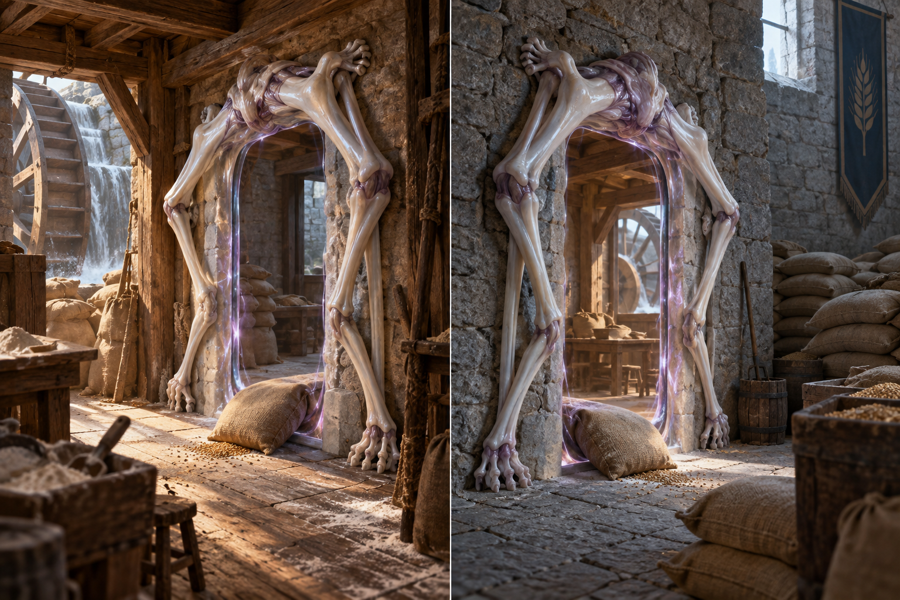

# 🚪 Les Entre-deux

[← Bestiaire](BESTIAIRE.md) · [Regroupements](REGROUPEMENTS.md) · [Magies humaines](../MAGIES_ET_RELATIONS.md)

## 📌 Statut

Développement issu de la discussion, enregistré à la demande de l’utilisateur. **L’Entre-deux est une créature dont le corps est réparti entre plusieurs lieux : le passage lui-même fait partie de son anatomie.** Les détails ci-dessous constituent la proposition de conception, illustrée par un individu à deux extrémités.

Cette première version colonise une connexion existante. Créer une destination nouvelle, multiplier les extrémités, se reproduire et quitter son habitat restent à définir. L’autonomie proposée appartient à la créature ; les passages humains exigent toujours des équipes aux deux extrémités.

## 👁️ Proposition visuelle

[Image complète](../visuels/entre-deux-v1.png) · [Prompt de génération](../visuels/entre-deux-v1-prompt.md)

Les deux vues représentent des parties du même individu, pas deux créatures indépendantes. Silhouette, disposition des membres et échelle sont illustratives.

## 🧩 Une anatomie répartie

À chaque extrémité, une couronne de membres s’attache autour d’une ouverture. Leurs postures maintiennent une géométrie commune, à la manière des équipes humaines de l’Espace. Les attaches prennent appui dans le bâtiment ; le lieu de passage appartient au corps de la créature.

Entre les membres apparaît une ouverture profonde, bordée d’une membrane, à travers laquelle on distingue l’autre lieu. Cette membrane n’est pas un filtre de Protection. Elle délimite la connexion plutôt qu’une surface destinée à arrêter les solides.

L’Entre-deux ne porte pas une porte sur son dos : **il est la connexion**. Chaque extrémité visible n’est qu’une partie de son anatomie.

| Partie ou relation | Fonction proposée |
|---|---|
| Membres périphériques | Délimitent et tiennent l’ouverture par leur posture. |
| Attaches | Fixent localement le corps aux supports disponibles. |
| Ouverture corporelle | Relie les lieux et permet la traversée. |
| Coordination entre extrémités | Ajuste les postures des parties distantes du même individu. |

## 🔄 Coordination instinctive

Une contraction à une extrémité entraîne un ajustement à l’autre. Les membres répondent aux déformations de leur connexion commune. Cette coordination appartient au fonctionnement instinctif de l’animal ; elle n’implique ni conscience ni conversation entre personnes.

Elle reprend sous forme corporelle ce que les humains doivent apprendre à accomplir collectivement. La proposition permet à l’Entre-deux de maintenir une liaison colonisée après le retrait des équipes humaines, sans donner ce pouvoir à un mage isolé.

Latence des réactions, résistance aux déformations et conséquences exactes d’une rupture restent ouvertes. Une réaction à distance dans son propre corps ne lui donne pas une perception générale des deux bâtiments.

## 📦 Instinct : maintenir la circulation

L’Entre-deux recherche les liaisons fréquentées et réagit aux traversées. **Le passage de matière est proposé comme un stimulus de maintien et de croissance**, pas comme une source d’énergie automatiquement suffisante.

Une liaison délaissée tend à se contracter. Une liaison très parcourue peut développer des attaches plus épaisses et une ouverture plus ample, dans des limites encore à définir. La créature ne juge pas l’utilité, la propriété ou la dangerosité des marchandises.

La durée sans circulation, les conditions de croissance et la réaction à un obstacle restent à préciser. L’absence de livraisons ne constitue pas un bouton d’arrêt immédiat.

## ⚡ Besoins et limites

- Une connexion préexistante fournit l’habitat initial de cette version.
- Les parties visibles ont besoin de supports où s’attacher.
- Le maintien et la croissance doivent disposer de ressources réelles ; leurs sources et mécanismes précis restent ouverts.
- Le transit ne crée ni ne duplique les marchandises. Un sac qui traverse arrive de l’autre côté.
- Aucune sélection automatique des personnes, intentions ou contaminants n’est acquise.
- L’élargissement n’implique ni capacité infinie ni création arbitraire d’un nouvel intérieur.
- Couper ou fermer un accès matériel ne garantit pas la disparition de la connexion.
- La fin du passage ne ramène pas à leur point de départ les voyageurs déjà arrivés.

Ce qui advient à un objet engagé dans une ouverture qui se contracte ou se rompt reste à définir avant d’en déduire un usage ou une procédure sûre.

## 🌾 Exemple proposé : le moulin et le grenier

### L’installation

Un Entre-deux s’installe dans une liaison entre un moulin et un grenier fortifié. Au moulin, ses membres pâles entourent l’arche de chargement. Au grenier, les autres parties de son corps agrippent les montants.

Les sacs traversent son ouverture. Les meuniers découvrent qu’il maintient la connexion après le retrait des équipes humaines. Un retourné organise les chargements pour entretenir l’activité de la créature. Son alimentation énergétique reste un paramètre à concevoir, distinct de cette stimulation par le trafic.

### La dépendance

Les livraisons finissent par s’organiser autour de cette liaison autonome. Le superviseur surveille les attaches et les traversées. Posséder le moulin ou le grenier ne suffit plus à commander le passage.

### La contamination

Une contamination apparaît dans le grenier. Les humains interrompent les livraisons et ferment les accès, mais l’Entre-deux maintient encore son ouverture.

Lorsque des ouvriers tentent de retirer ses attaches au moulin, les membres situés au grenier se crispent aussi. La géométrie du passage se déforme aux deux extrémités.

Les intervenants doivent tenir compte des deux parties d’un même animal, alors que l’un des lieux est dangereux. La scène ne garantit pas qu’un démontage simultané soit une méthode sûre : moyens de fermeture, réaction aux blessures et sort des parties séparées restent à définir.

**Son territoire est une relation entre des lieux.** Une décision locale peut affecter un autre bâtiment sans que ses occupants l’aient choisie.

## 🧙 Supervision par un retourné

Le superviseur entretient les appuis, organise la circulation et coordonne les interventions aux extrémités. Il cherche à orienter les réactions de l’animal par les conditions de son habitat.

Il gagne le maintien autonome d’une liaison colonisée. Il ne gagne pas automatiquement le choix de n’importe quelle destination ni l’obéissance à une fermeture demandée. Ses accords politiques doivent être négociés avec les humains des différents sites.

## 🕸️ Dans les Confluences

Les Architectes aveugles aménagent les supports et les abords ; les Greffiers colonisent les équipements ; l’Entre-deux maintient la liaison dont dépendent ces activités.

Cette version ne crée pas à elle seule de nouvelles destinations. L’extension d’une Confluence à d’autres lieux nécessite des connexions établies par des moyens disponibles, notamment les équipes humaines, ou une capacité ultérieure explicitement définie.

Un support retravaillé par un Architecte peut déformer les attaches. Un équipement étendu par un Greffier peut gêner le seuil. Le superviseur doit préserver la compatibilité matérielle et spatiale de l’ensemble.

Les formes occupant un réseau à plusieurs issues restent à développer. L’exemple à deux extrémités ne fixe pas le nombre maximal de parties d’un individu.

## ❓ Paramètres ouverts

Seuil de naissance (naissance proposée : la liaison tenue par relève et très parcourue, [Espace v1 § 7](../magies/ESPACE_V1.md#-7-le-sillon-de-lespace)), colonisation initiale, reproduction, alimentation, ressources de croissance, mobilité, nombre d’extrémités, éventuelle création de destinations, vitesse des réactions, capacités de transit, contraction, interruption et survie des parties séparées. Aucun coût, débit ni délai chiffré n’est fixé.
