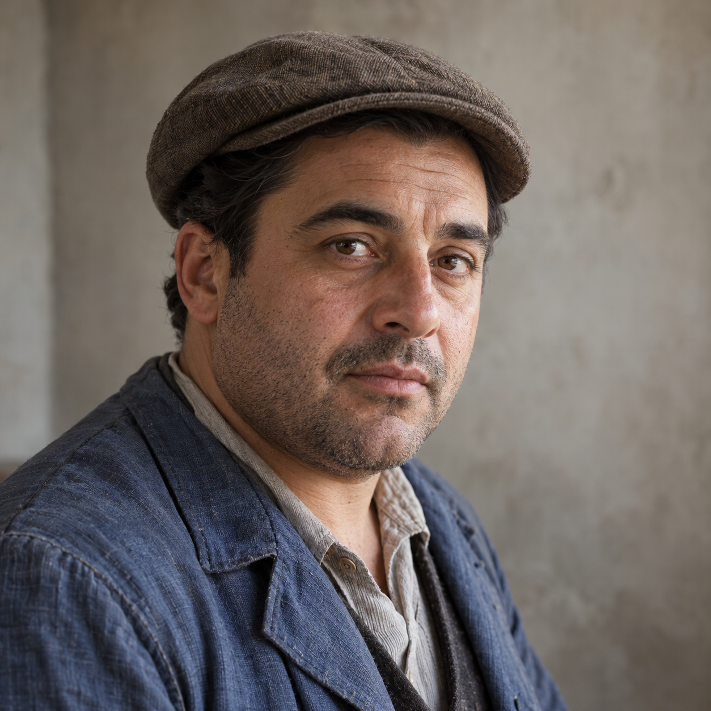
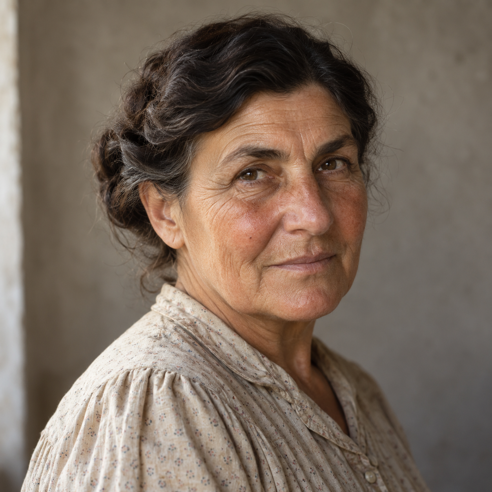
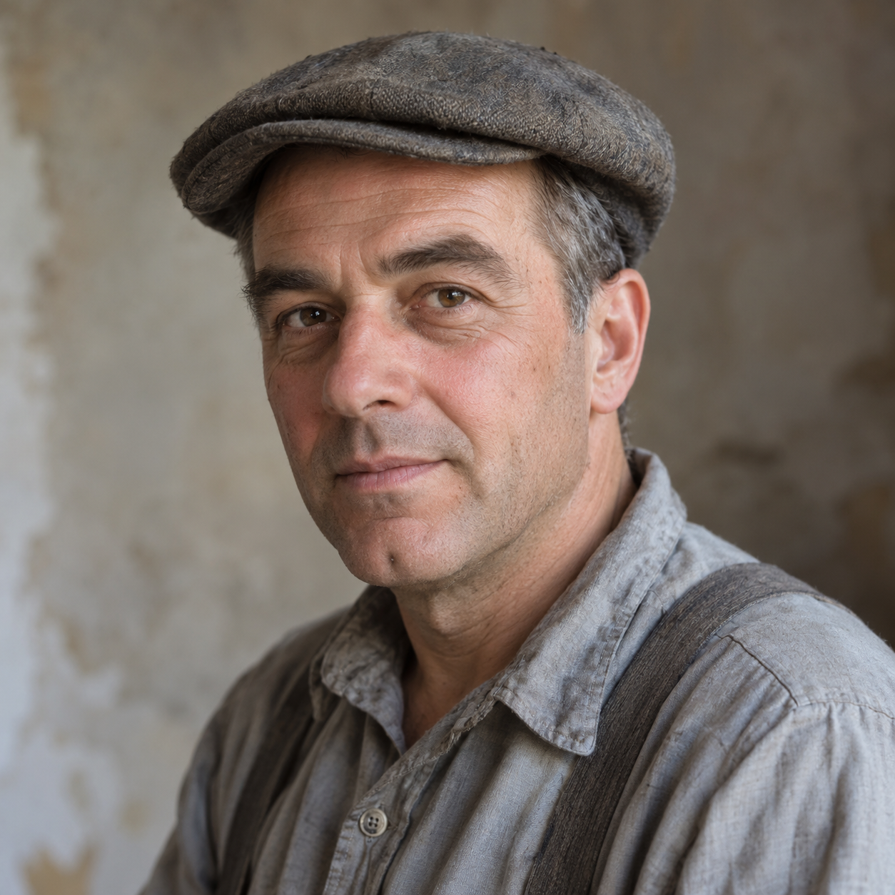
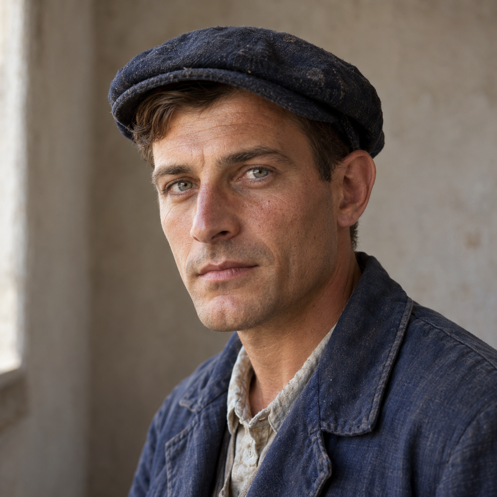
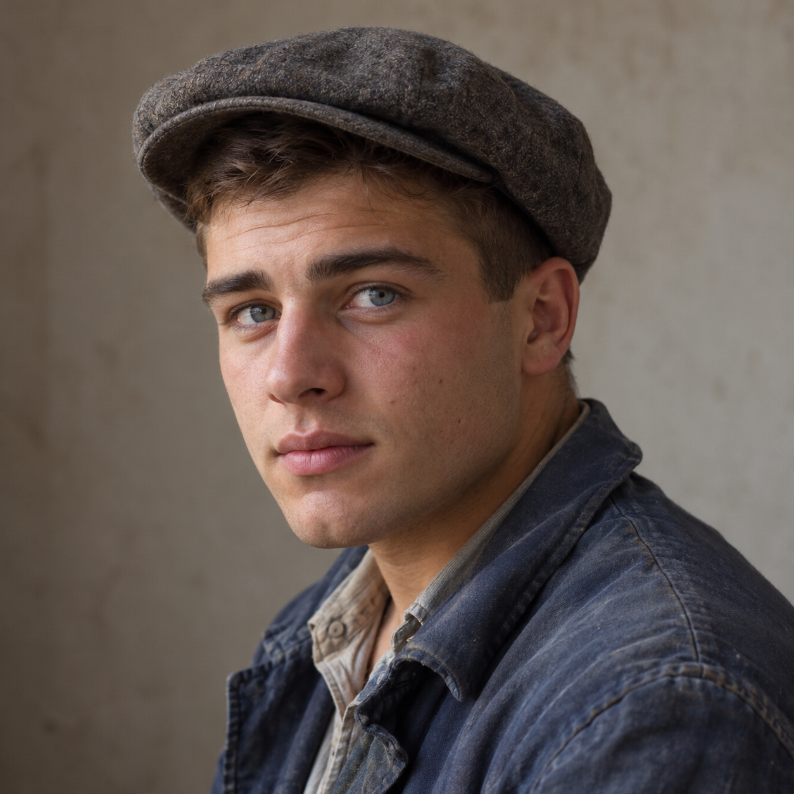
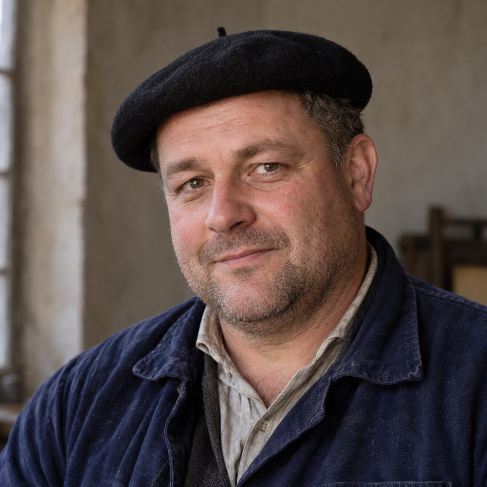
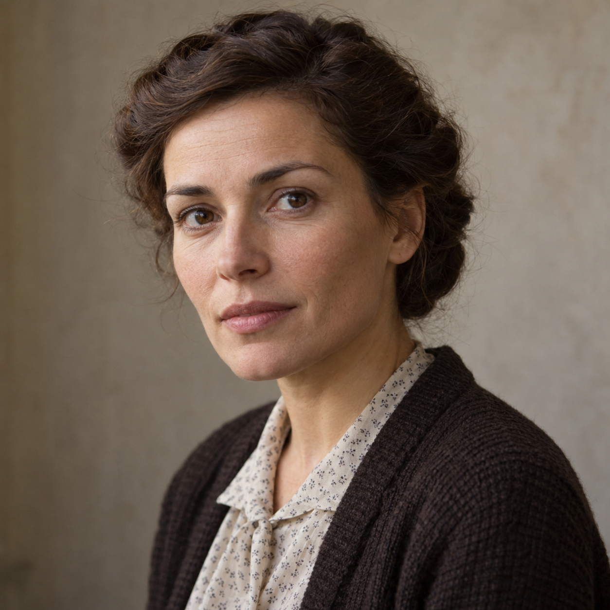
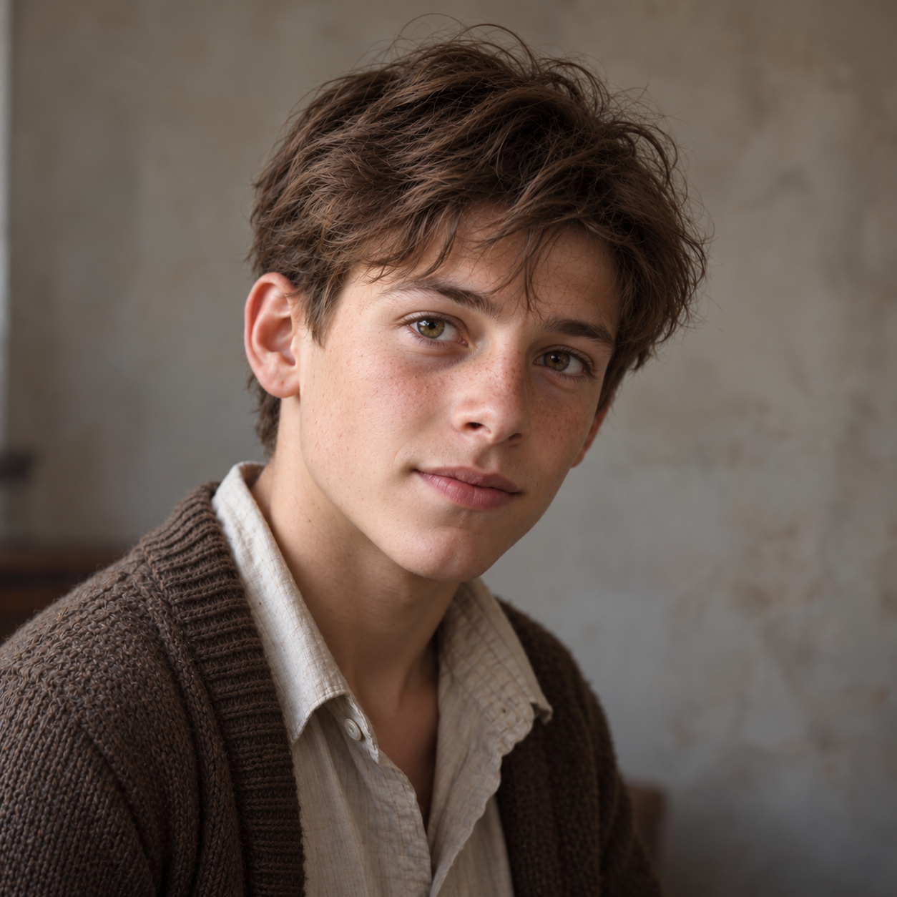

# Portraits — La peur et le geste

Portraits réalistes générés avec image_gen ; créations fictionnelles. Les apparences de Josette et Lucien sont proposées.

## Raymond Moreau

## Solange Joubert

## Émile Guillon

## Jacques Augereau

## Maurice Schneider

## Ernest Gaillard

## Josette Moreau

## Lucien

## Michel — 19 ans

